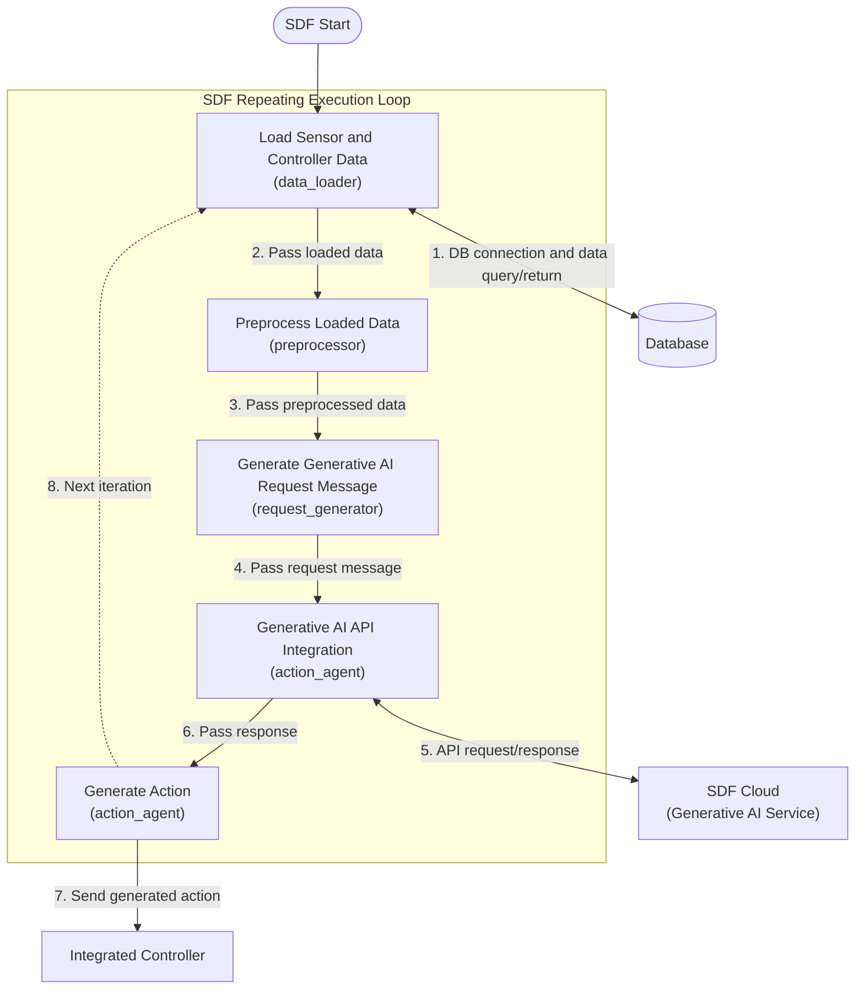

# SDF (Software Defined Farming)

- A core concept of smart farming that applies cutting-edge software technologies such as information and communication technology (ICT), artificial intelligence (AI), the Internet of Things (IoT), and big data across agriculture to monitor, analyze, and control cultivation environments, in order to improve agricultural productivity and reduce management costs.
- A structural concept that separates the hardware physical layer from the software control layer, redefining and operating agricultural systems with software at the center.

# Overview

- An SDF-specific system that supports precision-controlled agriculture using generative AI and an action agent, based on diverse environmental sensor data collected at demonstration farms and control data (tacit knowledge) from professional farm managers.

## Project Directory


```
SDF/
├── main.py                             # SDF main function
├── requirements.txt                    # Python package list
│ 
├── data_loader/
│   ├── get_raw_data.py                 # Loads sensor and controller data
│   └── real_time_db_load/
│       ├── main.py                     # Loads sensor and controller data per greenhouse
│       ├── config/
│       │   └── crop_info.csv           # Crop information per greenhouse
│       └── utility/
│           ├── loader.py               # Loads sensor and controller data
│           ├── settings.py             # Log settings
│           ├── db/
│           │   └── client.py           # DB connection and queries
│           └── query/
│               └── query_builder.py    # Generates SQL for querying sensors and controllers
│ 
├── preprocessor/
│   ├── main.py                         # Runs preprocessing steps sequentially
│   ├── delete_error_data.py            # Removes rows with large timestamp errors
│   ├── get_validate_area.py            # Computes the common valid interval across sensors
│   ├── time_sync.py                    # 1-minute time correction and alignment
│   ├── merge_data.py                   # Merges sensor and controller data
│   ├── merge_si_data.py                # 1-minute time correction and merge of solar radiation data
│   └── post_process_merged_data.py     # Joins crop information
│ 
├── request_generator/
│   ├── generate_request.py             # Combines the prompt with recent data to build the input request message
│   └── prompt_sample.md                # Sample prompt based on tacit knowledge
│ 
├── action_agent/
│   ├── main.py                         # Generative AI API integration, action generation
│   ├── validator.py                    # Action validation and correction
│   └── mqtt_sender.py                  # Sends control commands via MQTT
│ 
└── k8s/
    ├── configmap.yaml                  # Environment configuration values
    ├── secret.yaml                     # Sensitive values such as DB credentials
    ├── pvc.yaml                        # Log storage space
    └── deployment.yaml                 # SDF-Agent deployment settings

```

### main

The entire SDF operation runs repeatedly according to the following steps.

1. Load sensor and controller data (`data_loader`)
   - Connects to the DB and queries/returns sensor and controller data
2. Pass the loaded data
   - `data_loader` → `preprocessor`
3. Preprocess the loaded data (`preprocessor`)
   - Passes the preprocessed data to `request_generator`
4. Generate the generative AI request message (`request_generator`)
   - Passes the generated request message to `action_agent`
5. Integrate with the generative AI API (`action_agent`)
   - Connects to the "SDF Cloud" service, sends the request to the generative AI, and receives the response
6. Pass the response
   - Passes the generative AI response to the action generation step
7. Generate and send actions (`action_agent`)
   - Generates actions based on the response and sends them to the "Integrated Controller"





#### data_loader

Loads sensor and controller data sequentially according to the following steps.

1. Query the list of sensors and controllers installed at the site (`client.py`)
2. Generate query SQL for each sensor and controller (`query_builder.py`)
3. Load sensor and controller data (`loader.py`)
4. Join crop information per greenhouse (`crop_info.csv`)

#### preprocessor

Preprocesses sensor and controller data sequentially according to the following steps.

1. Remove abnormal data (`delete_error_data.py`)
2. Extract the common valid interval across sensors (`get_validate_area.py`)
3. 1-minute time correction and alignment (`time_sync.py`)
4. Merge sensor and controller data (`merge_data.py`)
5. Merge solar radiation data (`merge_si_data.py`)
6. Join crop information (`post_process_merged_data.py`)

#### request_generator

Converts the preprocessed data into a generative AI request message according to the following steps.

1. Load the sample prompt containing control goals and output format (`prompt_sample.md`)
2. Organize recent data by item (`generate_request.py`)
3. Combine the prompt and recent data to generate the request message (`generate_request.py`)

#### action_agent

Generates and delivers generative AI-based control actions.

1. Integrate with the generative AI API (`main.py`)
2. Validate and correct control commands (`validator.py`)
3. Send control commands to the integrated controller via MQTT (`mqtt_sender.py`)

## Installation and Execution

### Prerequisites

SDF assumes that the following environments are already installed.

- SDF Cloud
  - k8s
  - Ollama, LLM Model
- Edge Cluster
  - k3s
  - TimescaleDB, Mosquitto

### SDF Cloud

- The cloud environment responsible for generative AI inference.
- Ollama and an LLM must be running on a Kubernetes (k8s) cluster, and an API address accessible from the Edge Cluster must be provided.

### Edge Cluster

- The environment installed at the demonstration farm site, responsible for data collection and controller control.
- TimescaleDB (sensor data storage) and Mosquitto (controller command delivery) must be running on a Kubernetes (k3s) cluster.
- The demonstration farm's sensor data and controller information must be stored in TimescaleDB.

### Running the Action Agent

The YAML files in the `k8s/` folder are samples. Before running, modify the values in `configmap.yaml`, `secret.yaml`, `pvc.yaml`, and `deployment.yaml` to match your actual environment.

```bash
pushd "k8s"
kubectl apply -f configmap.yaml -f secret.yaml -f pvc.yaml -f deployment.yaml
popd
```
