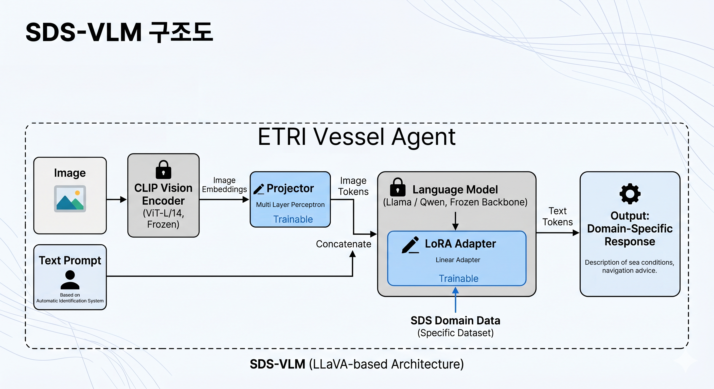
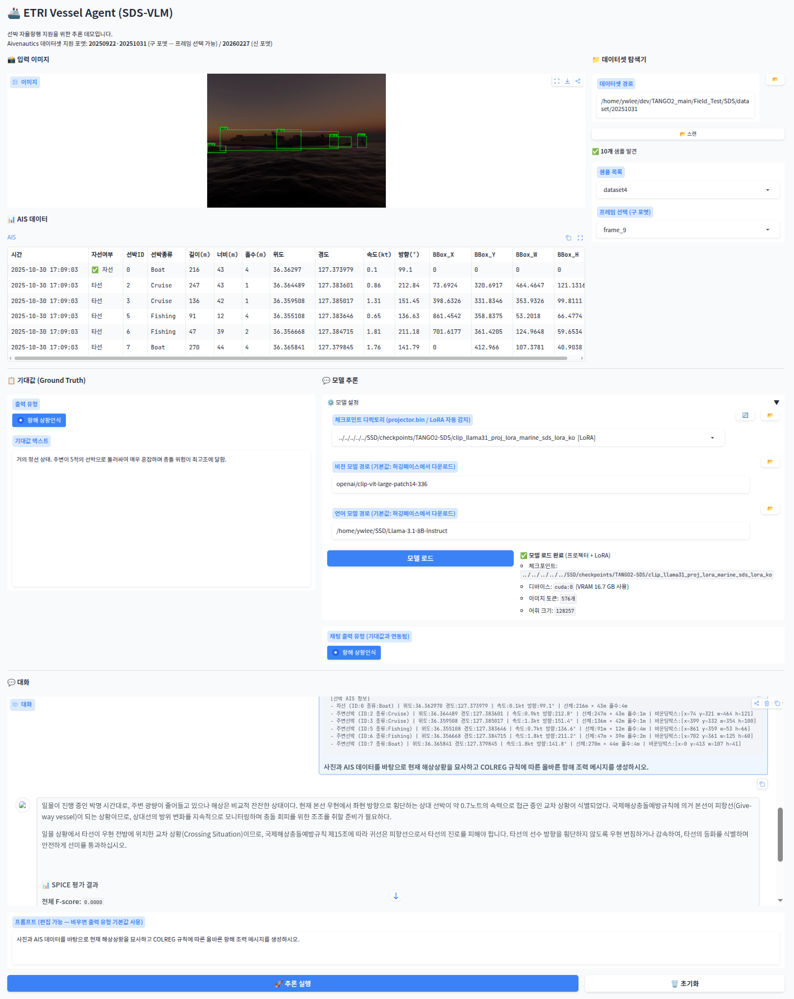
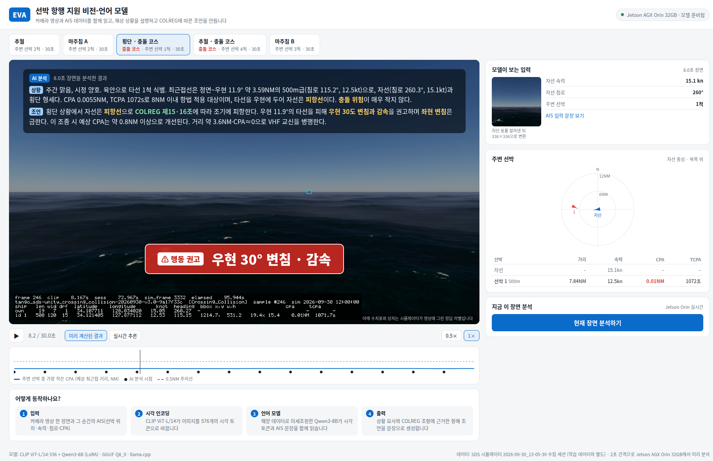

# EVA: ETRI Vessel Agent (SDS-VLM)

선박 자율항행 지원을 위한 비전-언어 모델(Vision-Language Model, VLM) 구현입니다.
CLIP 비전 인코더와 Qwen3 / Llama 3.1 언어 모델을 비전 프로젝터로 연결하는 LLaVA 구조이며,
SDS(Software-defined Ship) 해상 도메인 데이터셋에 특화된 학습 파이프라인을 제공합니다.

이 문서는 위에서 아래로 따라 하도록 구성되어 있습니다.
환경과 가중치·데이터를 준비하고(§2~§5), 모델 구조를 확인하고 학습 기록을 설정한 뒤(§6~§7) 네 단계로 학습하고(§8) 검증셋으로 채점합니다(§9).
학습을 건너뛰려면 §10-1 의 공개 체크포인트를 받아 §10 부터 시작합니다.
배포는 변환(§11)과 Jetson 실행(§12)을 거쳐 두 가지 데모(§13, §14)로 이어집니다.

---

## 목차

1. [아키텍처 개요](#1-아키텍처-개요)
2. [실험환경](#2-실험환경)
3. [가상환경 구성](#3-가상환경-구성)
4. [모델 가중치 준비](#4-모델-가중치-준비)
5. [데이터셋 준비](#5-데이터셋-준비)
6. [동작 확인](#6-동작-확인)
7. [W&B 학습 모니터링](#7-wb-학습-모니터링)
8. [학습](#8-학습)
9. [검증](#9-검증)
10. [추론](#10-추론)
11. [가중치 변환](#11-가중치-변환)
12. [Jetson AGX Orin 실행](#12-jetson-agx-orin-실행)
13. [데모 웹 앱](#13-데모-웹-앱)
14. [동영상 데모](#14-동영상-데모)
15. [프로젝트 구조](#15-프로젝트-구조)

---

## 1. 아키텍처 개요



- 본 구조도는 선박 및 해양 도메인 특화 데이터(**SDS Domain Data**)를 효율적으로 학습하여 해상 상황 묘사 및 항해 조언을 수행하는 **ETRI Vessel Agent** 의 멀티모달 아키텍처를 보여줍니다.

- 기존 LLM과 Vision Encoder는 고정(frozen)한 상태로, **Projector**와 **LoRA Adapter**만을 선택적으로 파인튜닝하는 효율적인 구조를 채택하고 있습니다.

### 1-1. 입력부 (Inputs)

멀티모달 처리를 위해 두 가지 형태의 서로 다른 데이터가 시스템의 시작점으로 입력됩니다.

> **Image (이미지)**
>* 분석 대상이 되는 해상 관련 시각 자료(예: 선박 주변 전경).


> **Text Prompt (텍스트 프롬프트)**
>* 사용자의 질의문 또는 **AIS(선박 자동 식별 시스템, Automatic Identification System)** 데이터를 기반으로 생성된 텍스트 명령지시어.

### 1-2. 시각 정보 처리부 (Vision Processing)

입력된 이미지를 언어 모델이 이해할 수 있는 형태(토큰)로 변환하고 정렬하는 구간입니다.

> **CLIP Vision Encoder (`ViT-L/14`)**
>* **설명:** OpenAI의 CLIP 모델을 백본으로 삼아 이미지에서 고차원의 시각적 특징을 추출합니다.
>* **상태:** 🔒 **Frozen (고정)** — 기구축된 시각 인식 능력을 유지하기 위해 가중치를 업데이트하지 않습니다.


> **Image Embeddings**
>* Vision Encoder로부터 출력된 고차원 이미지 특징 벡터 데이터입니다.


> **Projector (`Vision Projector`)**
>* **설명:** 이미지 임베딩을 언어 모델(LLM)이 단어처럼 인식할 수 있는 공간인 `Image Tokens`로 매핑해 주는 연결 다리입니다. 다층 퍼셉트론(Multi Layer Perceptron, MLP) 계열 외에 학습 가능한 쿼리를 사용하는 리샘플러 계열까지 5가지 구조를 선택할 수 있습니다. 자세한 내용은 [§1-2-1 프로젝터 구조 선택](#1-2-1-프로젝터-구조-선택)을 참조하세요.
>* **상태:** ✏️ **Trainable (학습 가능)** — 시각 정보와 언어 정보 간의 도메인 정렬을 위해 이 영역의 가중치는 **Full Tuning** 방식으로 직접 학습됩니다.

#### 1-2-1. 프로젝터 구조 선택

`--projector_type` 인수로 5가지 프로젝터 구조 중 하나를 선택해 학습할 수 있습니다.

| `--projector_type` | 구조 | 출력 이미지 토큰 수 |
|---|---|---|
| `linear` | `Linear` 1층 | 패치 수와 동일 |
| `mlp2x_gelu` | `Linear → GELU → Linear` (기본값, LLaVA 1.5와 동일) | 패치 수와 동일 |
| `mlp3x_gelu` | `Linear → GELU → Linear → GELU → Linear` | 패치 수와 동일 |
| `cross_attn` | 학습 가능한 쿼리가 패치 시퀀스에 교차 어텐션(cross-attention)을 수행하는 리샘플러 (Flamingo 계열) | `--projector_num_query_tokens` |
| `qformer` | `cross_attn` 블록에 쿼리 자기 어텐션(self-attention)을 추가한 구조 (BLIP-2 계열 Q-Former) | `--projector_num_query_tokens` |

앞의 세 구조는 비전 인코더가 내보낸 패치를 각각 독립적으로 사상하므로 이미지 토큰 수가 패치 수와 같습니다. CLIP ViT-L/14-336 기준으로 576개, SigLIP SO400M/14-384 기준으로 729개입니다.

뒤의 두 구조는 패치 수와 무관하게 고정된 개수의 쿼리 토큰을 내보냅니다. 기본값 32개를 사용하면 LLM에 삽입되는 이미지 토큰이 576개에서 32개로 줄어들어 시퀀스 길이와 어텐션 연산량이 감소합니다. 다만 패치 단위의 공간 격자가 보존되지 않습니다.

> 리샘플러 계열은 컨텍스트에 별도의 위치 임베딩을 더하지 않습니다. ViT가 이미 자체 위치 임베딩을 적용했으므로 위치 정보는 각 특징 벡터 안에 들어 있고, BLIP-2도 같은 방식으로 원본 ViT 특징을 Q-Former에 넣습니다. 그 결과 리샘플러의 연산은 시퀀스 축의 순서 변경에 대해 불변입니다. 단일 이미지에서는 문제가 되지 않지만, 비디오 인코더와 함께 쓸 때는 성립하지 않습니다. `video-languagebind` 경로는 각 프레임을 동일한 이미지 ViT로 통과시킨 뒤 `(B, T*N, D)` 로 이어 붙이므로, 프레임 구분은 오직 시퀀스 인덱스에만 남아 있습니다. 앞의 세 구조는 그 인덱스를 LLM 시퀀스까지 그대로 전달하여 LLM의 위치 인코딩이 프레임 순서를 복원하지만, 리샘플러는 이를 버립니다. 따라서 `cross_attn` 과 `qformer` 는 현재 단일 이미지 전용이며, 다중 프레임 인코더와 함께 쓰면 학습은 진행되고 손실값도 정상처럼 보이지만 시간 정보는 전달되지 않습니다.

`qformer`는 학습 가능한 쿼리에 자기 어텐션을 더한 구조라는 점에서 BLIP-2의 Q-Former와 같은 계열이지만, BLIP-2의 공개 가중치와 호환되지는 않습니다. BLIP-2의 Q-Former는 텍스트 분기를 공유하고 교차 어텐션을 12개 층에 격층으로 배치하기 때문입니다. 본 구현의 리샘플러는 모든 블록에서 교차 어텐션을 수행하며, 처음부터 학습하는 것을 전제로 합니다.

리샘플러 계열에만 적용되는 하이퍼파라미터는 다음과 같습니다.

| 인수 | 기본값 | 설명 |
|---|---|---|
| `--projector_num_query_tokens` | 32 | 학습 가능한 쿼리 토큰 개수. 출력 이미지 토큰 수와 같습니다. |
| `--projector_num_heads` | 8 | 리샘플러 블록당 어텐션 헤드 수 |
| `--projector_num_layers` | 2 | 리샘플러 블록 개수 |
| `--projector_ffn_ratio` | 4.0 | 블록 내 피드포워드 폭 배율 |
| `--projector_dropout` | 0.0 | 블록 내 드롭아웃 |
| `--projector_hidden_size` | 비전 인코더 폭 | 리샘플러 내부 연산 폭. 생략하면 비전 인코더의 hidden size를 사용합니다. |

`--projector_hidden_size`를 LLM 폭으로 올리는 것은 권장하지 않습니다. CLIP 1024와 Llama 4096 조합에서 내부 폭을 1024에서 4096으로 바꾸면 파라미터 수가 약 14배 증가합니다. `qformer` 기준으로 38.9 M에서 558.2 M이 되어 기본 프로젝터인 `mlp2x_gelu`(21.0 M)의 27배에 이릅니다. BLIP-2의 Q-Former도 LLM 폭이 아닌 768 차원에서 동작한 뒤 선형 변환으로 LLM 폭에 맞추며, 본 구현의 기본값도 같은 방식입니다.

CLIP ViT-L/14-336(1024)과 Llama 3.1-8B(4096) 조합에서 측정한 프로젝터 파라미터 수는 다음과 같습니다. 리샘플러는 쿼리 32개, 헤드 8개, 블록 2개, 내부 폭 1024 기준입니다.

| `--projector_type` | 출력 토큰 | 파라미터 수 |
|---|---|---|
| `linear` | 576 | 4.20 M |
| `mlp2x_gelu` | 576 | 20.98 M |
| `mlp3x_gelu` | 576 | 37.76 M |
| `cross_attn` | 32 | 30.48 M |
| `qformer` | 32 | 38.88 M |

선택한 구조와 하이퍼파라미터는 학습 결과 디렉토리의 `vlm_config.json`에 기록됩니다. 추론 스크립트는 `projector.bin` 옆의 `vlm_config.json`을 읽어 동일한 구조를 자동으로 복원하므로, 추론 시 프로젝터 인수를 다시 지정할 필요가 없습니다.

디스크에 있는 체크포인트가 여전히 적재되는지 확인하려면 다음을 실행합니다. 지정한 디렉토리를 재귀적으로 탐색하여 모든 `projector.bin`에 대해, 기록된 구조로 재구성한 프로젝터에 적재되는지와 나머지 4가지 구조에서는 거부되는지를 함께 확인합니다. `load_weights`, state dict 구성, 체크포인트 저장 방식을 변경한 뒤에 실행하십시오.

```bash
python scripts/verify_projector_checkpoints.py checkpoints/

# SigLIP 등 다른 폭으로 학습한 체크포인트
python scripts/verify_projector_checkpoints.py checkpoints/ \
    --vision_hidden_size 1152 --llm_hidden_size 4096
```

외부 포맷 변환 지원 범위는 대상 포맷이 표현할 수 있는 계산에 따라 결정됩니다.

| `--projector_type` | LLaVA HF | GGUF (clip.cpp) |
|---|---|---|
| `linear` | 변환 (출력 동치) | 불가 |
| `mlp2x_gelu` | 변환 | 변환 |
| `mlp3x_gelu` | 불가 | 불가 |
| `cross_attn` | 불가 | 불가 |
| `qformer` | 불가 | 불가 |

LLaVA HF의 `LlavaMultiModalProjector`는 `linear_1 → 활성 함수 → linear_2` 구조이고 활성 함수를 설정할 수 있습니다. `mlp2x_gelu`는 그대로 대응되고, `linear`는 활성 함수를 항등 함수로 두고 `linear_2`를 항등 행렬로 채우면 출력이 원본과 동일해집니다. GGUF의 `mlp` 그래프는 첫 행렬곱 뒤에 GELU를 조건 없이 적용하고 행렬곱이 최대 2회이므로 `mlp2x_gelu`만 표현됩니다.

`mlp3x_gelu`는 비선형이 2개 필요하지만 두 포맷 모두 1개만 지원합니다. 리샘플러 계열은 학습된 쿼리 토큰과 교차 어텐션을 담을 텐서가 없고, 이미지 토큰 수가 패치 수와 달라져 두 포맷의 토큰 계산 규칙과도 맞지 않습니다. 이는 대상 포맷의 성질이며 스크립트의 미구현이 아닙니다. 변환이 불가한 경우 스크립트는 사유와 근거 파일을 함께 출력하고 중단하며, 깨진 산출물을 남기지 않습니다.

변환할 수 없는 구조는 이 리포지토리의 추론 경로(`demo/app.py`, `api/`, `test.py`, `eval/generate.py`)로 서빙합니다. 이 경로들은 `projector.bin`과 `vlm_config.json`을 그대로 읽으므로 5가지 구조를 모두 지원합니다.

### 1-3. 융합 및 언어 모델부 (Multimodal Fusion & LLM)

시각 토큰과 텍스트 토큰을 결합하여, 도메인 특화 지식을 바탕으로 추론을 수행하는 핵심 두뇌 구간입니다.

> **Concatenate (연결)**
>* Projector를 거쳐 나온 `Image Tokens`와 사용자가 입력한 `Text Prompt` 토큰을 하나의 시퀀스로 길게 이어 붙여 LLM의 입력값으로 전달합니다.


> **Language Model (`Llama / Qwen`)**
>* **설명:** 시스템의 텍스트 생성 및 추론을 담당하는 대형 언어 모델(LLM) 백본입니다.
>* **상태:** 🔒 **Frozen Backbone (고정)** — 수십~수백억 개의 거대한 파라미터 본체는 연산 자원 절약 및 기본 언어 능력 보존을 위해 고정됩니다.


> **LoRA Adapter (`Linear Adapter`)**
>* **설명:** 고정된 LLM 레이어 옆에 병렬로 삽입되는 초소형 가중치 행렬 쌍(Linear Adapter)입니다.
>* **상태:** ✏️ **Trainable (학습 가능)** — 하단의 SDS Domain Data (Specific Dataset)인 선박/해양 전문 데이터를 주입받아 이 어댑터 영역만 집중적으로 파인튜닝(PEFT)됩니다.

### 1-4. 출력부 (Output)

모델이 최종 연산을 마치고 사용자에게 도메인 지식을 전달하는 단계입니다.

>**Text Tokens**
>* LLM과 LoRA 어댑터의 협업을 통해 생성된 언어 토큰 시퀀스입니다.


>**Output: Domain-Specific Response**
>* **최종 결과물:** 일반적인 답변을 넘어, 주입된 전문 데이터를 기반으로 생성된 **해상 상황 묘사(Description of sea conditions)** 및 **항해 조언(Navigation advice)** 등의 도메인 특화 답변을 출력합니다.

### 1-5. 학습 파이프라인

| 단계 | 데이터 | 학습 대상 | 고정 | 목적 |
|------|--------|-----------|------|------|
| Phase 1 | CC3M 595K | Projector | CLIP + LLM | 이미지↔텍스트 임베딩 정렬 |
| Phase 2 | CC3M 595K | Projector + LoRA | CLIP + LLM | 일반 시각-언어 파인튜닝 |
| Phase 3 | LLaMarine 54K (텍스트 전용) | LoRA | CLIP + Projector + LLM | 해양 도메인 지식 주입 |
| Phase 4 | SDS 20260728 9,000건 (이미지+텍스트) | Projector + LoRA | CLIP + LLM | SDS 태스크 특화 |

> * Phase 3 는 이미지 없이 텍스트만 사용하므로 Vision Encoder / Projector 를 로드하지 않고 LoRA Adapter 만 학습합니다.
> * 단계별 명령은 §8 에 있습니다.

---

## 2. 실험환경

| 항목         | 사양                                           |
|------------|----------------------------------------------|
| CPU        | Intel(R) Xeon(R) Gold 6348 CPU @ 2.60GHz × 2 |
| RAM        | 1TB                                          |
| GPU        | NVIDIA A100 (40GB) × 6                       |
| GPU Driver | 590.48.01                                    |
| CUDA       | 12.8                                         |
| cuDNN      | 9.20.0                                       |
| OS         | Ubuntu 24.04                                 |

---

## 3. 가상환경 구성

### 3-1. Miniforge 설치

```bash
wget "https://github.com/conda-forge/miniforge/releases/latest/download/Miniforge3-$(uname)-$(uname -m).sh"
bash Miniforge3-$(uname)-$(uname -m).sh -b -p $HOME/miniforge3
$HOME/miniforge3/bin/conda init bash # 또는 zsh
source ~/.bashrc # 또는 source ~/.zshrc 
```

### 3-2. 채널 설정 확인

> **중요: 라이센스 문제**  
> Anaconda 기본 채널(`defaults`)은 상업적 환경에서 유료입니다.  
> 연구·기관 환경에서는 반드시 `defaults`를 삭제하고 아래 무료 채널만 사용하십시오.

```bash
# Miniforge 는 conda-forge 를 기본 채널로 사용함
# nvidia, pytorch 채널을 추가할 것

conda config --add channels nvidia
conda config --add channels pytorch
conda config --show channels
```

올바른 출력:
```
channels:
  - nvidia
  - pytorch
  - conda-forge
```

### 3-3. 가상환경 생성

```bash
conda create -n eva python=3.11 pip -y
conda activate eva  # 이후 모든 코드는 가상환경이 활성화되어 있다고 가정함
```

이 환경 하나로 지원하는 언어 모델 전부를 학습합니다. 계열마다 요구 사항이 조금씩 다르므로 아래 표를 먼저 확인하십시오.

| 언어 모델 | 학습 진입점 | 최소 `transformers` | flash-attn | torchvision |
|-----------|-------------|---------------------|------------|-------------|
| Llama 3.1-8B-Instruct | `train.py` | 5.3.0 | 필요 | 불필요 |
| Qwen3-8B | `train.py` | 5.3.0 | 필요 | 불필요 |
| Gemma 4 E2B/E4B-it | `train_gemma4.py` | **5.14.1** | 불필요 | **필요** |

세 계열을 모두 다루려면 `transformers` 를 5.14.1 이상으로 맞추어야 합니다. 5.3.0 에는 `gemma4` 모듈이 아예 없습니다. 반대로 5.14.1 에서 Llama 와 Qwen 경로가 그대로 도는 것은 확인했습니다.

`train.py` 는 `model/vlm_v2.py` 에서 언어 모델을 `attn_implementation="flash_attention_2"` 로 적재하므로 flash-attn 이 없으면 시작하지 못합니다. `train_gemma4.py` 는 그것을 강제하지 않습니다.

`torchvision` 은 Gemma 4 의 이미지 프로세서가 `torchvision.transforms.v2` 를 쓰기 때문에 필요합니다. 없으면 `Gemma4Processor` 임포트 단계에서 실패합니다.

### 3-4. PyTorch 설치 (CUDA 12.8)

```bash
pip install torch==2.11.0 torchvision==0.26.0 --index-url https://download.pytorch.org/whl/cu128
```

설치 확인:
```bash
python -c "import torch, torchvision; print(torch.__version__, torchvision.__version__); print('CUDA:', torch.cuda.is_available())"
# 출력 예: 2.11.0+cu128 0.26.0+cu128   CUDA: True
```

`torchvision` 은 선택 사항이 아닙니다. Gemma 4 를 쓰지 않더라도 함께 설치해 두면 계열을 바꿀 때 다시 손댈 일이 없습니다.

### 3-5. 나머지 패키지 설치

```bash
pip install \
    transformers==5.14.1 \
    tokenizers==0.22.2  \
    huggingface_hub==1.7.2  \
    safetensors==0.8.0  \
    peft==0.18.1  \
    accelerate==1.13.0  \
    deepspeed==0.18.8 \
    sentencepiece==0.2.1  \
    einops==0.8.2 \
    wandb==0.26.1 \
    tensorboard==2.21.0 \
    torchinfo==1.8.0  \
    gradio==6.14.0  \
    pillow==12.1.1  \
    pandas==3.0.1 \
    numpy==2.4.3  \
    tqdm==4.67.3  \
    requests==2.32.5  \
    psutil==7.2.2 \
    triton==3.6.0 \
    pycocoevalcap==1.2
```

- `tensorboard` 는 `train.py` 와 `train_gemma4.py` 가 기본 로깅 대상으로 지정하므로 없으면 학습이 시작되지 않고 `TensorBoardCallback requires tensorboard to be installed` 로 중단됩니다.

검증셋 채점(`eval/metrics.py`)까지 돌리려면 다음을 추가합니다. 학습에는 필요하지 않습니다.

```bash
pip install \
    sacrebleu==2.6.0 \
    rouge-score \
    bert-score==0.3.13 \
    kiwipiepy==0.23.2 \
    nltk==3.10.3
```

- `kiwipiepy` 는 한국어 형태소 토큰화에 씁니다. 한국어는 어절 분절로 BLEU 와 ROUGE 를 계산하면 값이 불안정합니다.
- `bert-score` 는 한국어 인코더(`klue/roberta-large`)로 의미 유사도를 잽니다.
- `pycocoevalcap` 은 CIDEr 계산에 씁니다. 같은 꾸러미의 `SPICE` 는 Stanford CoreNLP 기반 영어 전용이라 한국어에 쓰지 않으며, 따라서 `JAVA` 도 필요하지 않습니다. `SPICE` 를 쓰는 경우에는 아래를 설치하십시오. §13 데모 웹 앱은 추론 결과마다 `SPICE` 점수를 계산하므로 데모를 쓰려면 필요합니다.

```bash
sudo apt install openjdk-11-jdk
```

#### 설치 확인

세 계열이 모두 준비되었는지 한 번에 확인합니다.

```bash
python - <<'PY'
import torch, torchvision, transformers, peft, os
print("torch       ", torch.__version__, "| CUDA:", torch.cuda.is_available())
print("torchvision ", torchvision.__version__)
print("transformers", transformers.__version__, "| peft", peft.__version__)

models = os.path.join(os.path.dirname(transformers.__file__), "models")
print("gemma4 지원 :", "gemma4" in os.listdir(models))
try:
    import flash_attn
    print("flash-attn  ", flash_attn.__version__)
except ImportError:
    print("flash-attn   없음 — train.py 는 쓸 수 없고 train_gemma4.py 만 가능합니다")
PY
```

### 3-6. Flash Attention 2 빌드 및 설치

- RAM 이 충분하다면 빠른 빌드를 위해 MAX_JOBS 의 숫자를 높입니다.
- MAX_JOBS=1 이면 64GB RAM 에서 빌드 가능

```bash
MAX_JOBS=1 pip install flash-attn==2.8.3 --no-build-isolation
```

---

## 4. 모델 가중치 준비

- TANGO2 저장소는 `$HOME` 아래에 있다고 가정합니다. 이후 모든 명령은 이 디렉토리에서 실행합니다.

```bash
cd ~/TANGO2/Field_Test/SDS/VisionLanguageModel/
```

- Hugging Face Access Token 을 발급받아 로그인합니다.

```bash
hf auth login
```

### 4-1. 비전 모델

```bash
hf download openai/clip-vit-large-patch14-336 \
    --local-dir ~/clip-vit-large-patch14-336
```

결과물:

```bash
clip-vit-large-patch14-336
├── config.json
├── merges.txt
├── preprocessor_config.json
├── pytorch_model.bin
├── README.md
├── special_tokens_map.json
├── tf_model.h5
├── tokenizer_config.json
├── tokenizer.json
└── vocab.json
```

### 4-2. 언어 모델

이 문서의 명령은 Qwen3-8B 를 기준으로 합니다. Llama 3.1 은 §8-6 에서 바꿀 부분만 설명합니다.

```bash
hf download Qwen/Qwen3-8B \
    --local-dir ~/Qwen3-8B
```

결과물:

```bash
Qwen3-8B
├── config.json
├── generation_config.json
├── LICENSE
├── merges.txt
├── model-00001-of-00005.safetensors
├── model-00002-of-00005.safetensors
├── model-00003-of-00005.safetensors
├── model-00004-of-00005.safetensors
├── model-00005-of-00005.safetensors
├── model.safetensors.index.json
├── README.md
├── tokenizer_config.json
├── tokenizer.json
└── vocab.json
```

Llama 3.1 8B Instruct 를 쓰려면 함께 받습니다. Meta 라이선스 동의가 필요합니다.

```bash
hf download meta-llama/Llama-3.1-8B-Instruct \
    --local-dir ~/Llama-3.1-8B-Instruct
```

---

## 5. 데이터셋 준비

학습 네 단계(§8)가 쓰는 데이터는 세 가지입니다.

| 데이터 | 쓰는 단계 | 형태 |
|---|---|---|
| LLaVA-CC3M-Pretrain-595K | Phase 1, Phase 2 | 이미지 + 캡션 대화 |
| LLaMarine-SFT | Phase 3 | 텍스트 전용 명령-응답 |
| AIVN-SDS 20260728 | Phase 4, 검증(§9) | 이미지 + AIS + 국문 상황묘사·항해조언 |

### 5-1. LLaVA-CC3M-Pretrain-595K

```bash
hf download liuhaotian/LLaVA-CC3M-Pretrain-595K \
    --local-dir ~/LLaVA-CC3M-Pretrain-595K \
    --repo-type dataset
cd ~/LLaVA-CC3M-Pretrain-595K && unzip -q images.zip -d images && cd -
```

- 압축을 푼 뒤 `images/GCC_train_*.jpg` 형태가 되어야 합니다. 압축 안에 폴더가 한 겹 더 있으면 파일을 `images/` 바로 아래로 옮깁니다.

결과물:

```bash
LLaVA-CC3M-Pretrain-595K
├── chat.json
├── images
│   ├── GCC_train_000000000.jpg
│   ├── GCC_train_000000001.jpg
│   ...
├── images.zip
├── metadata.json
└── README.md
```

### 5-2. LLaMarine-SFT (텍스트 전용 해양 도메인)

- [Llamarine](https://huggingface.co/pentagoniac/llamarine) 에서 구축한 54,657개의 해양 instruction-output 쌍으로 구성된 영문 텍스트 전용 데이터셋입니다.
- 이미지 없이 해양 도메인 지식(AIS, COLREG, 충돌 회피 등)을 LLM 에 주입합니다.

```bash
hf download pentagoniac/llamarine-sft \
    --local-dir ~/llamarine-sft \
    --repo-type dataset
```

결과물:

```bash
llamarine-sft/
├── data
│   └── train-00000-of-00001.parquet
└── README.md
```

### 5-3. AIVN-SDS 20260728

SDS 시뮬레이터 이미지에 항해사가 국문 상황묘사와 항해조언을 단 10,000건의 데이터셋입니다.
Hugging Face 데이터셋 저장소 `ETRI-TANGO/AIVN-SDS` 에서 받아 임의의 경로에 둡니다.

```bash
hf download ETRI-TANGO/AIVN-SDS \
    --local-dir ~/AIVN-SDS \
    --repo-type dataset
```

결과물:

```bash
AIVN-SDS
├── README.md
└── 20260728
    ├── png/          # {이름}.png             1920×1080 시뮬레이터 이미지 (10,000장)
    ├── csv/          # {이름}.csv             자선·타선 AIS (위치, 속력, 침로, 선체, bbox, CPA, TCPA)
    ├── describe_ko/  # {이름}.describe_ko.txt 국문 해상상황묘사
    └── advice_ko/    # {이름}.advice_ko.txt   국문 항해조언
```

이후 명령에서 이 경로를 `SDS_DIR` 로 부릅니다. `20260728` 폴더 자체를 가리켜야 합니다.

```bash
export SDS_DIR=~/AIVN-SDS/20260728
```

학습셋 9,000건과 검증셋 1,000건을 LLaVA 형식 JSON 으로 만듭니다.
분할은 고정 시드로 섞어 정하므로 같은 `--seed` 면 같은 분할이 재현됩니다.

```bash
python scripts/prepare_sds_dataset.py \
    --dataset_dir "$SDS_DIR" \
    --valid_ratio 0.1 \
    --seed 42
```

결과물:

```bash
data/
├── sds_train_ko_9k.json   # 학습 9,000건
└── sds_valid_ko_1k.json   # 검증 1,000건 (학습에 쓰지 않음)
```

- 두 파일은 저장소에도 들어 있습니다. 위 명령으로 Hugging Face 배포본에서 다시 만든 결과는 저장소의 파일과 바이트 단위로 같습니다.
- 스크립트는 두 셋에 겹치는 샘플이 없고 합이 변환된 전체 샘플 수(이 배포본은 10,000건)와 같은지 확인한 뒤 끝납니다.
- JSON 의 `image` 는 `png/{이름}.png` 처럼 `SDS_DIR` 기준 상대 경로입니다. 학습과 검증에서 `--image_dir "$SDS_DIR"` 로 넘깁니다.

JSON 샘플의 형식:

```json
{
  "id": "{이름}_ko",
  "image": "png/{이름}.png",
  "conversations": [
    {
      "from": "human",
      "value": "<image>\n[선박 AIS 정보]\n- 자선 (ID:0) | 위도:35.133232 경도:128.741344 | 속도:23.2kt 방향:146.0° | 선체:19m × 7m 흘수:1m\n- 주변선박 (ID:1) | ... | CPA:0.0917NM TCPA:307.87초\n\n사진과 AIS 데이터를 바탕으로 현재 해상상황을 묘사하고 COLREG 규칙에 따른 올바른 항해 조력 메시지를 생성해줘."
    },
    {
      "from": "gpt",
      "value": "{describe_ko}\n\n{advice_ko}"
    }
  ]
}
```

- AIS 문장에서 바운딩박스는 뺍니다. CSV 의 `bbox_*` 는 배포본에 따라 이미지 좌표계와 맞지 않은 적이 있어, 학습 입력에서 제외했습니다.

---

## 6. 동작 확인

학습을 시작하기 전에 비전 모델과 언어 모델의 구조와 forward pass 가 정상인지 확인합니다.

| 인수 | 설명 |
|---|---|
| `--vision` | 비전 모델 경로 (§4-1) |
| `--llm` | 언어 모델 경로 (§4-2) |
| `--device` | `cuda:0` 또는 `cpu` |
| `--dtype` | `bfloat16` / `float16` / `float32` |
| `--generate` | 지정하면 텍스트 응답까지 생성 |
| `--test_image` | 테스트 이미지 경로 |
| `--projector_type` | 프로젝터 구조 ([§1-2-1](#1-2-1-프로젝터-구조-선택), 기본 `mlp2x_gelu`) |

```bash
python load_test.py \
    --vision     ~/clip-vit-large-patch14-336 \
    --llm        ~/Qwen3-8B \
    --device     cuda:0 \
    --dtype      bfloat16 \
    --test_image "$SDS_DIR/png/tango_sds-unity_headon-20260710-v3.0-1d948bc6.png" \
    --generate

# 프로젝터 구조를 바꿔 확인하는 예시 (이미지 토큰 576개 → 32개)
python load_test.py --vision ~/clip-vit-large-patch14-336 --llm ~/Qwen3-8B \
    --projector_type qformer --projector_num_query_tokens 32
```

정상 출력 시 마지막 줄:

```bash
ALL CHECKS PASSED — Model architecture is functional
```

---

## 7. W&B 학습 모니터링

§8 의 명령은 `--wandb_project vlm-v2` 로 W&B 에 기록합니다. 최초 1회 로그인합니다.

```bash
wandb login
```

로깅 항목:
- `train/loss`, `train/learning_rate`, `train/grad_norm`
- `gpu/{i}/mem_allocated_GB`, `gpu/{i}/mem_reserved_GB` (GPU별)
- 모델 설정, 하이퍼파라미터 (run config)

W&B 없이 실행하려면 명령 앞에 `WANDB_MODE=disabled` 를 붙이거나 `--wandb_project` 인수를 빼면 됩니다.

모델 구조를 확인하려면 다음을 실행합니다.

```bash
python model_summary.py                        # 콘솔 출력
python model_summary.py --wandb_project vlm-v2 # W&B 아티팩트 업로드
```

---

## 8. 학습

### 8-0. 단계와 공통 설정

| 단계 | 진입점 | 데이터 | 학습 대상 | 고정 | 출력 디렉토리 |
|---|---|---|---|---|---|
| Phase 1 | `train.py --train_type projector` | CC3M 595K | Projector | CLIP + LLM | `checkpoints/clip_qwen3_proj` |
| Phase 2 | `train.py --train_type lora` | CC3M 595K | Projector + LoRA | CLIP + LLM | `checkpoints/clip_qwen3_proj_lora` |
| Phase 3 | `train_text_lora.py` | LLaMarine 54,657건 | LoRA | CLIP + Projector + LLM | `checkpoints/clip_qwen3_proj_lora_marine` |
| Phase 4 | `train.py --train_type lora` | SDS 9,000건 (+ 검증 1,000건) | Projector + LoRA | CLIP + LLM | `checkpoints/clip_qwen3_proj_lora_marine_sds_ko_9k` |

각 단계는 앞 단계의 출력 디렉토리를 입력으로 받습니다.
아래 하이퍼파라미터는 `scripts/train_projector_chain_qwen3.sh` 의 값입니다. 공개 체크포인트(§10-1) 중 프로젝터 구조별 체크포인트가 이 값으로 학습되었습니다.
그 스크립트는 같은 네 단계를 Phase 1, 2, 2b, 3 이라는 이름으로 부릅니다. 이 문서의 Phase 3, 4 가 각각 2b, 3 에 해당합니다.

경로 변수와 GPU 수를 먼저 정합니다. 유효 배치(GPU당 배치 × 누적 × GPU 수)는 GPU 수와 관계없이 단계마다 고정합니다.

```bash
cd ~/TANGO2/Field_Test/SDS/VisionLanguageModel
export CLIP=~/clip-vit-large-patch14-336
export LLM=~/Qwen3-8B
export CC3M=~/LLaVA-CC3M-Pretrain-595K
export MARINE=~/llamarine-sft/data/train-00000-of-00001.parquet
export SDS_DIR=~/AIVN-SDS/20260728            # §5-3

NGPU=1                                        # 사용할 GPU 수 (CUDA_VISIBLE_DEVICES 로 고른 장수)
if [ "$NGPU" -gt 1 ]; then
    RUN="python -m torch.distributed.run --nproc_per_node=$NGPU"
    DS="--deepspeed scripts/zero2.json"
else
    RUN="python"; DS=""
fi
ACC32=$(( 32 / (2 * NGPU) ))                  # 유효 배치 32 (GPU당 배치 2)
ACC64=$(( 64 / (2 * NGPU) ))                  # 유효 배치 64 (Phase 3)
```

- 나눗셈은 정수로 버림되므로 `NGPU` 는 1, 2, 4, 8 처럼 32 와 64 를 나누어 떨어지게 하는 값을 씁니다. 3장이면 누적이 5가 되어 유효 배치가 30이 됩니다.

| 단계 | 유효 배치 | 학습률 | 길이 | step 수 (스크립트 주석) |
|---|---|---|---|---|
| Phase 1 | 32 | 1e-3 | 5,000 step | 5,000 |
| Phase 2 | 32 | 2e-4 | 1 epoch | 18,606 |
| Phase 3 | 64 | 5e-5 | 1 epoch | 855 |
| Phase 4 | 32 | 2e-4 | 3 epoch | 846 |

### 8-1. Phase 1 — 프로젝터 사전학습

비전 인코더와 LLM 을 고정하고 비전 프로젝터만 학습합니다. 프로젝터 구조는 `--projector_type` 으로 고릅니다([§1-2-1](#1-2-1-프로젝터-구조-선택)).

```bash
$RUN train.py \
    --train_type projector \
    --vision_model "$CLIP" --llm_model "$LLM" \
    --projector_type mlp2x_gelu \
    --data_path "$CC3M/chat.json" --image_dir "$CC3M/images" \
    --output_dir checkpoints/clip_qwen3_proj \
    --num_epochs 1 --max_steps 5000 \
    --batch_size 2 --grad_accum $ACC32 \
    --learning_rate 1e-3 --lr_scheduler cosine --warmup_ratio 0.03 \
    --max_seq_len 2048 --dtype bfloat16 --gradient_checkpointing \
    --save_steps 2500 --save_total_limit 1 --logging_steps 50 --dataloader_workers 8 \
    --wandb_project vlm-v2 $DS
```

결과물: `checkpoints/clip_qwen3_proj/` (`projector.bin`, `vlm_config.json`, 토크나이저)

### 8-2. Phase 2 — CC3M 프로젝터 + LoRA

Phase 1 의 프로젝터를 이어받아 프로젝터와 LLM 의 LoRA 를 함께 학습합니다.

```bash
$RUN train.py \
    --train_type lora \
    --vision_model "$CLIP" --llm_model "$LLM" \
    --projector_type mlp2x_gelu \
    --projector_path checkpoints/clip_qwen3_proj/projector.bin \
    --data_path "$CC3M/chat.json" --image_dir "$CC3M/images" \
    --output_dir checkpoints/clip_qwen3_proj_lora \
    --num_epochs 1 \
    --batch_size 2 --grad_accum $ACC32 \
    --learning_rate 2e-4 --lr_scheduler cosine --warmup_ratio 0.03 \
    --lora_r 128 --lora_alpha 256 \
    --max_seq_len 2048 --dtype bfloat16 --gradient_checkpointing \
    --save_steps 5000 --save_total_limit 2 --logging_steps 50 --dataloader_workers 8 \
    --wandb_project vlm-v2 $DS
```

결과물: `checkpoints/clip_qwen3_proj_lora/` (`projector.bin`, `adapter_model.safetensors`, `adapter_config.json`, `vlm_config.json`, 토크나이저)

### 8-3. Phase 3 — LLaMarine 텍스트 전용 LoRA 계속학습

Phase 2 의 LoRA 를 이어받아 해양 도메인 텍스트로 LoRA 만 추가 학습합니다.
비전 인코더와 프로젝터는 적재하지 않습니다. `projector.bin` 과 `vlm_config.json` 은 출력 디렉토리로 복사되어 Phase 4 가 그대로 이어 씁니다.

```bash
$RUN train_text_lora.py \
    --llm_model "$LLM" \
    --lora_path checkpoints/clip_qwen3_proj_lora \
    --data_path "$MARINE" \
    --output_dir checkpoints/clip_qwen3_proj_lora_marine \
    --num_epochs 1 \
    --batch_size 2 --grad_accum $ACC64 \
    --learning_rate 5e-5 \
    --max_seq_len 2048 --dtype bfloat16 --gradient_checkpointing \
    --save_steps 400 --logging_steps 50 --dataloader_workers 4 \
    --wandb_project vlm-v2 $DS
```

- 학습률을 Phase 2 보다 낮게 두는 것은 앞 단계에서 학습한 내용을 잊는 현상(catastrophic forgetting)을 줄이기 위함입니다.

결과물: `checkpoints/clip_qwen3_proj_lora_marine/`

### 8-4. Phase 4 — SDS 도메인 LoRA 파인튜닝

§5-3 에서 만든 9,000건으로 Phase 3 의 LoRA 와 프로젝터를 이어받아 학습합니다.
`--valid_data_path` 로 넘긴 검증셋 1,000건의 손실을 `--eval_steps` 마다 잽니다.

```bash
$RUN train.py \
    --train_type lora \
    --vision_model "$CLIP" --llm_model "$LLM" \
    --projector_type mlp2x_gelu \
    --projector_path checkpoints/clip_qwen3_proj_lora_marine/projector.bin \
    --resume_lora_path checkpoints/clip_qwen3_proj_lora_marine \
    --data_path data/sds_train_ko_9k.json --image_dir "$SDS_DIR" \
    --valid_data_path data/sds_valid_ko_1k.json \
    --output_dir checkpoints/clip_qwen3_proj_lora_marine_sds_ko_9k \
    --num_epochs 3 \
    --batch_size 2 --grad_accum $ACC32 \
    --learning_rate 2e-4 --lr_scheduler cosine --warmup_ratio 0.03 \
    --max_seq_len 2048 --dtype bfloat16 --gradient_checkpointing \
    --save_steps 200 --save_total_limit 2 --eval_steps 100 --logging_steps 10 \
    --dataloader_workers 4 \
    --wandb_project vlm-v2 $DS
```

결과물: `checkpoints/clip_qwen3_proj_lora_marine_sds_ko_9k/`

```bash
clip_qwen3_proj_lora_marine_sds_ko_9k
├── adapter_config.json
├── adapter_model.safetensors   # LoRA 와 확장된 입출력 임베딩
├── all_results.json
├── eval_results.json           # 검증셋 1,000건 손실
├── chat_template.jinja
├── projector.bin
├── tokenizer_config.json
├── tokenizer.json
└── vlm_config.json
```

이 디렉토리가 §9 검증, §10 추론, §11 변환의 입력입니다.

### 8-5. 네 단계를 한 번에 실행

`scripts/train_projector_chain_qwen3.sh` 는 8-1 부터 8-4 까지를 같은 값으로 차례로 실행합니다.

- 파일 위쪽의 `CC3M_DATA`, `CC3M_IMG`, `MARINE_DATA`, `SDS_IMG` 를 §5 의 경로로 고칩니다. `PYTHON` 과 `LLM_MODEL` 은 환경 변수로 넘길 수 있습니다. 비전 모델은 `openai/clip-vit-large-patch14-336` 으로 고정되어 있어 Hugging Face 캐시에서 읽습니다.
- `PROJECTOR_TYPE` 은 반드시 지정합니다. 출력 디렉토리는 `clip_qwen3_projector_<구조>`, `clip_qwen3_proj_lora_<구조>`, `clip_qwen3_proj_lora_marine_<구조>`, `clip_qwen3_proj_lora_marine_sds_ko_9k_<구조>` 입니다.
- `PHASES` 로 일부 단계만 돌릴 수 있습니다 (예: `PHASES="2b 3"`).
- 사용할 GPU 수가 유효 배치 32 와 64 를 나누어 떨어지게 해야 합니다 (1, 2, 4, 8장 등).

```bash
CUDA_VISIBLE_DEVICES=0,1,2,3 PYTHON=$(which python) LLM_MODEL=~/Qwen3-8B \
PROJECTOR_TYPE=mlp2x_gelu \
    bash scripts/train_projector_chain_qwen3.sh
```

### 8-6. Llama 3.1 로 학습할 때

8-0 의 `LLM` 을 `~/Llama-3.1-8B-Instruct` 로 바꾸고, 출력 디렉토리 이름의 `clip_qwen3_` 를 `clip_llama31_` 로 바꾸어 같은 순서로 실행합니다.
나머지 인수는 같습니다.

### 8-7. `train.py` 참고 사항

주요 `train.py` 인수:

| 인수 | 설명 |
|------|------|
| `--train_type` | `projector` / `lora` / `full` |
| `--projector_type` | `linear` / `mlp2x_gelu` / `mlp3x_gelu` / `cross_attn` / `qformer` ([§1-2-1](#1-2-1-프로젝터-구조-선택)) |
| `--projector_path` | 이어받을 `projector.bin` 경로 |
| `--resume_lora_path` | 이어받을 LoRA 디렉토리 |
| `--valid_data_path` / `--eval_steps` | 검증셋 경로와 평가 주기 |
| `--lora_r` / `--lora_alpha` | LoRA rank / alpha (기본: 128 / 256) |
| `--max_steps` | epoch 대신 step 수로 조기 종료 |
| `--save_total_limit` | 보관할 `checkpoint-N` 개수 (생략 시 전부 보관) |
| `--deepspeed` | DeepSpeed 설정 파일 (`scripts/zero2.json`, `scripts/zero3.json`) |
| `--wandb_project` | W&B 프로젝트명 (생략 시 비활성화) |

#### 체크포인트 크기

`VisionLanguageModelV2`는 `PreTrainedModel`이 아니므로, HF Trainer는 기본적으로 `state_dict` 전체를 `model.safetensors` 한 파일로 씁니다. 동결된 CLIP 3억과 LLM 80억이 매 체크포인트마다 따라 들어가 16.7 GB가 됩니다. 프로젝터만 학습하는 단계에서 실제로 달라진 것은 78 MB뿐입니다.

동결된 부분은 사전학습 소스에서 다시 만들어지므로 저장하지 않습니다. `VLMTrainer._save`가 프로젝터 전체와 `requires_grad`인 파라미터만 남기며, 후자가 LoRA 어댑터와 full 파인튜닝의 LLM 가중치를 덮습니다. 실측값은 다음과 같습니다.

| 단계 | `model.safetensors` | 체크포인트 디렉토리 |
|---|---|---|
| `projector` (변경 전) | 16.7 GB | 16.8 GB |
| `projector` | 77.8 MB (730개 중 48개 텐서) | 314 MB |
| `lora` (r=8) | 161.6 MB (1178개 중 496개) | — |

resume 시 빠진 동결 파라미터는 `build_model`이 사전학습 소스에서 만든 값이 그대로 쓰입니다. 늘어난 `<image>` 임베딩 행도 샘플링이 아니라 기존 임베딩의 통계로 결정되므로 재현됩니다. 변경 전에 저장한 전체 크기 체크포인트도 그대로 이어서 학습할 수 있습니다.

> DeepSpeed 실행에는 이 필터가 닿지 않는 파일이 하나 더 있습니다. `global_stepN/mp_rank_00_model_states.pt`는 DeepSpeed가 직접 쓰는 모듈 전체의 fp32 사본이며 8B 기준 33.4 GB입니다. `DeepSpeedEngine.save_checkpoint`에 `exclude_frozen_parameters=True`를 넘기면 77.8 MB로 줄어드는 것을 확인했으나, 그렇게 저장한 체크포인트는 되살릴 수 없습니다. `transformers`가 resume 시 `load_module_strict=not _is_peft_model(self.model)`로 호출하고 이 모델은 최상위가 `PeftModel`이 아니므로, 동결된 CLIP 키에서 `RuntimeError`로 거부됩니다. 따라서 이 부분은 줄이지 않았습니다. DeepSpeed 실행의 총 디스크 사용량은 `--save_total_limit`으로 제한하십시오. 예를 들어 `--save_total_limit 2`는 오래된 체크포인트를 지워 총량을 두 개분으로 묶습니다.

> 프로젝터 구조를 바꾸면 `projector.bin`의 파라미터 구성도 달라집니다. Phase 1에서 학습한 프로젝터를 Phase 2 이후에서 이어받을 때는 두 단계의 `--projector_type` 및 리샘플러 하이퍼파라미터가 일치해야 합니다. 추론 스크립트와 달리 `train.py`는 체크포인트의 `vlm_config.json`을 자동으로 읽지 않으므로 인수를 직접 맞춰 주어야 합니다. 구성이 어긋난 경우 학습이 시작되지 않고 중단됩니다. 검출되는 경우는 다음과 같습니다.

| 어긋난 항목 | 검출 방식 |
|---|---|
| `--projector_type` | 텐서 이름이 달라짐 |
| `--projector_num_layers` | 블록 수만큼 텐서 이름이 달라짐 |
| `--projector_num_query_tokens` | `proj.query` 의 형상이 달라짐 |
| `--projector_hidden_size` | 여러 텐서의 형상이 달라짐 |
| `--projector_num_heads` | `proj.arch_signature` 에 기록된 값이 달라짐 |

`--projector_num_heads` 는 별도의 처리가 필요합니다. PyTorch의 `nn.MultiheadAttention` 은 헤드 수를 파라미터나 버퍼가 아닌 일반 정수로 보관하므로, 헤드 수를 바꾸어도 텐서 이름과 형상이 전혀 달라지지 않습니다. 따라서 헤드 수만 다른 체크포인트는 이름·형상 검사를 모두 통과합니다. 이를 막기 위해 리샘플러는 쿼리 토큰 수, 헤드 수, 블록 수, 내부 폭을 `proj.arch_signature` 버퍼에 기록하고 로드 시 값을 비교합니다.

이어받을 값은 Phase 1 결과 디렉토리의 `vlm_config.json`에서 확인할 수 있습니다.

> `train.py`는 `--output_dir`에 `checkpoint-N` 디렉토리가 남아 있으면 자동으로 그 지점부터 이어서 학습합니다. 이때 복원 대상에는 프로젝터 가중치도 포함되므로, 같은 `--output_dir`에 다른 `--projector_type`으로 실행하면 구조가 맞지 않습니다. 이 경우 학습을 시작하기 전에 체크포인트에 기록된 값과 요청한 값을 대조하여 중단하며, 어느 항목이 다른지 함께 출력합니다. 다른 구조로 새로 학습할 때는 `--output_dir`를 다른 경로로 지정하십시오.

---

## 9. 검증

§8-4 의 결과물을 §5-3 의 검증셋 1,000건으로 확인합니다. 검증셋은 학습에 쓰지 않았습니다.

### 9-1. 검증 손실

Phase 4 를 `--valid_data_path` 와 함께 돌렸다면 출력 디렉토리의 `eval_results.json` 에 검증셋의 다음 토큰 예측 손실(`eval_loss`)이 남습니다.

```bash
cat checkpoints/clip_qwen3_proj_lora_marine_sds_ko_9k/eval_results.json
```

- 이 값은 참조 문장의 토큰 분포와의 거리만 나타냅니다. 생성 문장의 사실 정확도나 COLREG 판단의 타당성은 9-2, 9-3 에서 잽니다.
- 토크나이저가 다른 언어 모델끼리는 손실값을 같은 척도로 비교할 수 없습니다.

### 9-2. 검증셋 응답 생성 (`eval/generate.py`)

검증셋 JSON 의 프롬프트를 그대로 넣어 greedy 디코딩으로 응답을 만듭니다. 프롬프트를 다시 만들지 않으므로 학습 입력과 같은 형식이 들어갑니다.

```bash
mkdir -p results/eval
python eval/generate.py \
    --llm_model      ~/Qwen3-8B \
    --projector_path checkpoints/clip_qwen3_proj_lora_marine_sds_ko_9k/projector.bin \
    --lora_path      checkpoints/clip_qwen3_proj_lora_marine_sds_ko_9k \
    --data_path      data/sds_valid_ko_1k.json \
    --image_dir      "$SDS_DIR" \
    --out            results/eval/qwen3_sds9k.jsonl
```

| 인수 | 기본값 | 설명 |
|---|---|---|
| `--vision_model` | `openai/clip-vit-large-patch14-336` | 비전 모델 경로 |
| `--projector_type` | 체크포인트의 `vlm_config.json` | 프로젝터 구조. 생략하면 체크포인트 설정을 따름 |
| `--limit` | 0 | 앞 N 건만 생성 (0 이면 전체). 빠르게 확인할 때 `--limit 20` |
| `--batch_size` | 8 | 배치 크기 |
| `--max_new_tokens` | 512 | 최대 생성 토큰 수 |

결과물은 한 줄이 한 샘플인 JSONL 입니다.

```json
{"id": "...", "image": "png/....png", "reference": "참조 문장", "prediction": "생성 문장", "raw": "디코딩 원문"}
```

- `prediction` 은 Qwen3 의 `</think>` 앞 사고 구간을 뺀 문장입니다.

### 9-3. 채점 (`eval/metrics.py`)

§3-5 의 채점용 패키지가 필요합니다.

```bash
python eval/metrics.py \
    --pred      results/eval/qwen3_sds9k.jsonl \
    --image_dir "$SDS_DIR" \
    --out       results/eval/qwen3_sds9k.metrics.json
```

세 갈래로 잽니다.

| 갈래 | 지표 |
|---|---|
| 표면 | BLEU-1~4, ROUGE-1/2/L, METEOR, chrF++, CIDEr-D (한국어는 Kiwi 형태소 단위) |
| 의미 | BERTScore (`klue/roberta-large`) |
| 내용 | 조우 유형, 항법상 지위, COLREG 조항, 권고 조종, 수치 일치도 |

- 수치 일치도의 정답은 참조 문장이 아니라 `SDS_DIR/csv/` 의 원본 값입니다. 그래서 `--image_dir` 에 데이터셋 경로를 넘깁니다.
- BERTScore 를 건너뛰려면 `--skip_bertscore` 를 붙입니다.

---

## 10. 추론

### 10-1. 공개 체크포인트

학습을 건너뛰려면 공개 체크포인트를 받습니다. 받은 디렉토리는 §8 의 출력 디렉토리와 같은 구성이므로 §9 와 이후 절에서 `checkpoints/...` 대신 그 경로를 넣으면 됩니다.


- 프로젝터와 LoRA 가중치는 [TANGO2 허깅페이스 저장소](https://huggingface.co/ETRI-TANGO/tango2-sds-vlm-eva) 에 있습니다.

```bash
hf download ETRI-TANGO/tango2-sds-vlm-eva \
    --local-dir ~/tango2-sds-vlm-eva
```

결과물: 

```bash
tango2-sds-vlm-eva
├── clip_llama31_proj
├── clip_llama31_proj_lora
├── clip_llama31_proj_lora_marine
├── clip_llama31_proj_lora_marine_sds_ko_9k
├── clip_llama31_proj_lora_marine_sds_lora_en
├── clip_llama31_proj_lora_marine_sds_lora_ko
├── clip_qwen3_proj
├── clip_qwen3_proj_lora
├── clip_qwen3_proj_lora_cross_attn
├── clip_qwen3_proj_lora_linear
├── clip_qwen3_proj_lora_marine
├── clip_qwen3_proj_lora_marine_cross_attn
├── clip_qwen3_proj_lora_marine_linear
├── clip_qwen3_proj_lora_marine_mlp3x_gelu
├── clip_qwen3_proj_lora_marine_qformer
├── clip_qwen3_proj_lora_marine_sds_ko_9k
├── clip_qwen3_proj_lora_marine_sds_ko_9k_cross_attn
├── clip_qwen3_proj_lora_marine_sds_ko_9k_linear
├── clip_qwen3_proj_lora_marine_sds_ko_9k_mlp3x_gelu
├── clip_qwen3_proj_lora_marine_sds_ko_9k_qformer
├── clip_qwen3_proj_lora_mlp3x_gelu
├── clip_qwen3_proj_lora_qformer
├── clip_qwen3_projector_cross_attn
├── clip_qwen3_projector_linear
├── clip_qwen3_projector_mlp3x_gelu
├── clip_qwen3_projector_qformer
├── gemma4_e4b_sds_ko_9k_lora
├── .gitattributes
└── README.md
```

디렉토리마다 담긴 파일은 학습 단계에 따라 다릅니다.

| 파일 | 담긴 내용 | 있는 디렉토리 |
|------|-----------|---------------|
| `projector.bin` | 비전 프로젝터 가중치 | 전부 |
| `tokenizer.json`, `tokenizer_config.json`, `chat_template.jinja` | 토크나이저와 대화 서식 | 전부 |
| `vlm_config.json` | 비전 인코더, 언어 모델, 프로젝터 구조 설정 | `clip_llama31_proj`, `clip_qwen3_proj`, `clip_llama31_proj_lora_marine`, `gemma4_e4b_sds_ko_9k_lora` 를 제외한 전부 |
| `adapter_config.json`, `adapter_model.safetensors` | LoRA 어댑터와 확장된 입출력 임베딩 | 프로젝터만 학습한 디렉토리를 제외한 전부 |
| `eval_results.json`, `all_results.json` | 검증셋 1,000건에 대한 손실 | 이름이 `_sds_ko_9k` 로 끝나거나 그 뒤에 프로젝터 구조가 붙은 디렉토리 |
| `connector.bin`, `processor_config.json`, `gemma4_train_config.json` | Gemma 4 의 비전 커넥터와 전처리기 설정 | `gemma4_e4b_sds_ko_9k_lora` |

이름 끝의 `_9k` 는 20260728 데이터셋의 한글 시나리오 9,000건으로 학습했다는 뜻입니다. `_9k` 가 붙지 않은 `_sds_lora_ko` / `_sds_lora_en` 은 이 문서에서 다루지 않는 이전 데이터셋으로 학습된 별개의 체크포인트입니다.

이름 끝의 `_linear`, `_cross_attn`, `_mlp3x_gelu`, `_qformer` 는 비전 프로젝터 구조를 가리킵니다. 구조 이름이 붙지 않은 CLIP 계열 체크포인트의 프로젝터는 `mlp2x_gelu` 입니다.

언어 모델별 체크포인트는 다음과 같습니다.

| 디렉토리 | 언어 모델 | 이어받은 체크포인트 | 학습 데이터 | 최종 검증 손실 |
|----------|-----------|---------------------|-------------|----------------|
| `clip_qwen3_proj_lora_marine` | Qwen3-8B | `clip_qwen3_proj_lora` | LLaMarine-SFT 54,657건, 1 epoch (855 step) | 측정 안 함 |
| `clip_qwen3_proj_lora_marine_sds_ko_9k` | Qwen3-8B | `clip_qwen3_proj_lora_marine` | SDS 20260728 한글 9,000건, 3 epoch (846 step) | 0.1903 |
| `clip_llama31_proj_lora_marine_sds_ko_9k` | Llama-3.1-8B-Instruct | `clip_llama31_proj_lora_marine` | SDS 20260728 한글 9,000건, 3 epoch (846 step) | 0.2260 |
| `gemma4_e4b_sds_ko_9k_lora` | Gemma-4-E4B-it | `google/gemma-4-E4B-it` | SDS 20260728 한글 9,000건, 3 epoch (846 step) | 0.2085 |

CLIP 계열 세 체크포인트의 비전 인코더는 `openai/clip-vit-large-patch14-336` 이고 프로젝터는 `mlp2x_gelu` 입니다. LoRA 는 `r=128`, `lora_alpha=256`, 대상 모듈은 `q_proj`, `k_proj`, `v_proj`, `o_proj`, `gate_proj`, `up_proj`, `down_proj` 입니다. `gemma4_e4b_sds_ko_9k_lora` 는 CLIP 을 쓰지 않는 네이티브 멀티모달 구조이며 별도 기준선입니다.

비전 프로젝터 구조별 체크포인트는 Qwen3-8B 로 고정하고 프로젝터 구조만 바꾸어 Phase 1 부터 Phase 4 까지 전 단계를 새로 학습한 것입니다. 단계별 디렉토리는 `clip_qwen3_projector_<구조>`, `clip_qwen3_proj_lora_<구조>`, `clip_qwen3_proj_lora_marine_<구조>`, `clip_qwen3_proj_lora_marine_sds_ko_9k_<구조>` 입니다.

| 프로젝터 구조 | 프로젝터 파라미터 | 이미지 토큰 수 | 최종 검증 손실 |
|---------------|-------------------|----------------|----------------|
| `linear` | 4,198,400 (4.20M) | 576 | 0.1857 |
| `mlp2x_gelu` (구조 이름 없음) | 20,979,712 (20.98M) | 576 | 0.1903 |
| `cross_attn` | 30,479,364 (30.48M) | 32 | 0.1866 |
| `mlp3x_gelu` | 37,761,024 (37.76M) | 576 | 0.1857 |
| `qformer` | 38,880,260 (38.88M) | 32 | 0.1853 |

`mlp2x_gelu` 는 앞선 학습에서 만든 체크포인트입니다. Phase 3 과 Phase 4 의 학습 조건은 나머지 넷과 같으나 Phase 1 과 Phase 2 는 이번 일괄 실행에서 만들어진 것이 아니므로 조건이 같은지 확인할 수 없습니다.

검증 손실은 학습에 쓰지 않은 20260728 한글 1,000건에 대한 다음 토큰 예측 손실이며 `eval_results.json` 에 함께 담겨 있습니다. 서로 다른 언어 모델의 값은 서로 다른 토크나이저가 만든 서로 다른 토큰 열에 대한 교차 엔트로피이므로 같은 척도로 비교할 수 없습니다. 프로젝터 구조별 값은 토크나이저가 같으므로 이 제약을 받지 않습니다. 다만 이 값은 어느 경우에도 참조 문장의 토큰 분포와의 거리만 나타내며 생성 품질, 묘사의 사실 정확도, COLREG 조항 인용의 타당성을 나타내지 않습니다.

### 10-2. 단일 이미지 추론 (`test.py`)

이미지 한 장에 자유 형식 질문을 던지는 가장 간단한 추론 스크립트입니다.
학습 형식(AIS 문장 + 지시문)과 같은 입력으로 몇 건만 보고 싶다면 §9-2 의 `eval/generate.py` 에 `--limit` 를 붙여 씁니다.

| 인수 | 기본값 | 설명 |
|------|--------|------|
| `--projector_path` | (필수) | projector.bin 경로 |
| `--image` | (필수) | 입력 이미지 경로 |
| `--lora_path` | None | LoRA 어댑터 디렉토리 (없으면 projector만 사용) |
| `--vision_model` | `openai/clip-vit-large-patch14-336` | 비전 모델 경로 |
| `--llm_model` | `Llama-3.1-8B-Instruct` | 언어 모델 경로 |
| `--question` | `"Describe this image in detail."` | 질문 프롬프트 |
| `--max_new_tokens` | 512 | 최대 생성 토큰 수 |
| `--temperature` | 0.2 | 샘플링 온도 (`--do_sample` 활성화 시 적용) |
| `--top_p` | 0.9 | Top-p 샘플링 (`--do_sample` 활성화 시 적용) |
| `--do_sample` | false | 샘플링 활성화 (기본: greedy) |
| `--repetition_penalty` | 1.0 | 반복 억제 (1.1 권장) |
| `--device` | `cuda:0` | 추론 디바이스 |
| `--dtype` | `bfloat16` | 모델 dtype (`bfloat16` / `float16` / `float32`) |

```bash
python test.py \
  --projector_path checkpoints/clip_qwen3_proj_lora_marine_sds_ko_9k/projector.bin \
  --lora_path      checkpoints/clip_qwen3_proj_lora_marine_sds_ko_9k \
  --vision_model   ~/clip-vit-large-patch14-336 \
  --llm_model      ~/Qwen3-8B \
  --image          "$SDS_DIR/png/tango_sds-unity_headon-20260710-v3.0-1d948bc6.png" \
  --question       "현재 해상 상황을 묘사하고 COLREG 에 따른 항해 조언을 제시하시오." \
  --max_new_tokens 512 \
  --repetition_penalty 1.1
```

- 프로젝터 구조는 `projector.bin` 옆의 `vlm_config.json` 에서 읽으므로 따로 지정하지 않습니다.

---

## 11. 가중치 변환

- 학습 후 생성된 체크포인트(Projector, LoRA)와 베이스모델(CLIP, Qwen/Llama) 을 프로덕션 추론 엔진용으로 변환합니다.
- `adapter_config.json` 이 없어도 변환 스크립트가 weight 형상으로 자동 재구성합니다.  
- 변환 가능한 프로젝터 구조는 대상 포맷이 표현할 수 있는 계산에 따라 제한됩니다. LLaVA HF 는 `linear` 와 `mlp2x_gelu`, GGUF 는 `mlp2x_gelu` 만 변환됩니다. 지원 범위와 근거는 [§1-2-1](#1-2-1-프로젝터-구조-선택)에 정리되어 있습니다. 변환할 수 없는 구조는 스크립트가 사유를 출력하고 중단하며, 이 리포지토리의 추론 경로로 서빙합니다.  
- LoRA rank=128, target_modules: `q_proj`, `k_proj`, `v_proj`, `o_proj`, `gate_proj`, `up_proj`, `down_proj`

### 11-1. vLLM 배포 (`convert_to_llava_hf.py`)

- HuggingFace `LlavaForConditionalGeneration` 포맷으로 변환합니다.  
- vLLM 또는 `transformers` 에서 직접 로드 가능합니다.

```bash
python scripts/convert_to_llava_hf.py \
  --ckpt_dir   checkpoints/clip_qwen3_proj_lora_marine_sds_ko_9k/ \
  --llm_path   ~/Qwen3-8B \
  --clip_model ~/clip-vit-large-patch14-336 \
  --output_dir ~/llava_hf_merged \
  --bf16
```

| 옵션 | 기본값 | 설명 |
|------|--------|------|
| `--ckpt_dir` | (필수) | 체크포인트 디렉토리 |
| `--llm_path` | (필수) | base LLM 경로 (로컬 경로 또는 HF 모델 ID) |
| `--clip_model` | (필수) | CLIP 모델 경로 (로컬 경로 또는 HF 모델 ID) |
| `--output_dir` | (필수) | 출력 디렉토리 |
| `--bf16` / `--fp16` | bfloat16 | 저장 dtype |
| `--max_shard_gb` | 4.0 | shard 최대 크기 (GB) |

결과물:

```bash
llava_hf_merged/
├── config.json                           # LlavaConfig
├── tokenizer.json / tokenizer_config.json
├── model-00001-of-NNNNN.safetensors      # sharded 가중치
└── model.safetensors.index.json
```

**projector 키 매핑**

| 원본 (커스텀) | 변환 후 (LLaVA HF) |
|---|---|
| `proj.0.weight` / `proj.0.bias` | `multi_modal_projector.linear_1.weight` / `.bias` |
| `proj.2.weight` / `proj.2.bias` | `multi_modal_projector.linear_2.weight` / `.bias` |

**vLLM 서빙**

```bash
vllm serve ~/llava_hf_merged \
  --trust-remote-code \
  --max-model-len 4096
```

### 11-2. llama.cpp 배포 (`convert_to_gguf.py`)

- `llama.cpp` 에서 사용하는 GGUF 포맷으로 변환합니다.
- `llama.cpp` 는 $HOME 경로에 미리 설치되어 있다고 가정합니다.
- 비전 프로젝터의 변환 결과(`mmproj.gguf`)는 이 스크립트가 직접 생성하고, LLM 본체(`llm.gguf`)는 llama.cpp 의 `convert_hf_to_gguf.py` 로 별도 변환합니다.
- `mmproj.gguf` 는 학습 경로와 같은 계산이 되도록 다음과 같이 기록됩니다.
  - CLIP 블록은 `vision_feature_layer=-2` 에 해당하는 23개만 담습니다.
  - `post_layernorm` 은 담지 않습니다. 학습은 `hidden_states[-2]` 를 LayerNorm 없이 사용합니다.
  - `clip.use_gelu` 는 CLIP 의 `hidden_act` 를 따릅니다. OpenAI CLIP 은 `quick_gelu` 이므로 `false` 로 기록됩니다.

**Step 0 — llama.cpp 소스 패치 (CLIP 계열 필수)**

- llama.cpp 의 LLaVA 그래프(`tools/mtmd/models/llava.cpp`)는 CLS 토큰을 패치 뒤에 붙인 다음 위치 임베딩 0..576 을 순서대로 더합니다.
- HF CLIP 은 CLS 를 맨 앞(위치 0)에 둡니다. 따라서 패치 없이 실행하면 패치마다 위치 임베딩이 한 칸씩 어긋나고, 프로젝터 입력의 마지막 행에 CLS 가 섞입니다.
- 이 차이는 GGUF 변환으로 보정할 수 없으므로 빌드 전에 한 줄을 고칩니다. 확인한 커밋은 `c479922ac` (2026-10-06) 입니다.

```bash
cd ~/llama.cpp
sed -i 's/inp = ggml_concat(ctx0, inp, model.class_embedding, 1);/inp = ggml_concat(ctx0, model.class_embedding, inp, 1);/' \
  tools/mtmd/models/llava.cpp
git diff --stat   # tools/mtmd/models/llava.cpp | 2 +-
```

- 검증 결과(검증셋 앞 20건, greedy, PyTorch BF16 기준, BF16 GGUF)는 다음과 같습니다.

| 조건 | 출력 완전 일치 | 문자 유사도 평균 / 최소 |
|---|---|---|
| 패치 전 | 3/20 | 0.935 / 0.817 |
| 패치 후 | 7/20 | 0.982 / 0.913 |

**Step 1 — mmproj.gguf + merged_llm 생성**

```bash
python scripts/convert_to_gguf.py \
  --ckpt_dir      checkpoints/clip_qwen3_proj_lora_marine_sds_ko_9k/ \
  --llm_path      ~/Qwen3-8B \
  --clip_model    ~/clip-vit-large-patch14-336 \
  --llama_cpp_dir ~/llama.cpp \
  --output_dir    ~/gguf_output
```

| 옵션 | 기본값 | 설명 |
|------|--------|------|
| `--ckpt_dir` | (필수) | 체크포인트 디렉토리 |
| `--llm_path` | (필수) | base LLM 경로 (로컬 경로 또는 HF 모델 ID) |
| `--clip_model` | (필수) | CLIP 모델 경로 (로컬 경로 또는 HF 모델 ID) |
| `--llama_cpp_dir` | (필수) | llama.cpp 리포지토리 경로 (`gguf-py` 로드에 사용) |
| `--output_dir` | (필수) | 출력 디렉토리 |
| `--bf16` / `--fp16` | bfloat16 | merged_llm 저장 dtype |
| `--skip_merge` | false | LoRA merge 건너뜀 (`merged_llm/` 이미 존재 시) |

**Step 2 — llm.gguf 변환**

```bash
python ~/llama.cpp/convert_hf_to_gguf.py \
  ~/gguf_output/merged_llm \
  --outfile ~/gguf_output/llm.gguf \
  --outtype bf16
```

결과물:

```
gguf_output/
├── merged_llm/          # 중간 산출물 — LoRA 병합된 LLM (HF 포맷)
├── mmproj.gguf          # CLIP + mlp2x_gelu projector (~1.25 GB)
└── llm.gguf             # LLM 본체 (bf16 ~16 GB, q8_0 ~8.7 GB)
```

- 양자화는 `--outtype q8_0` 으로 바로 만들 수 있습니다.

**Step 3 — llama-mtmd-cli 실행**

- 학습은 `CLIPImageProcessor` 로 짧은 변을 336 으로 줄인 뒤 가운데 336×336 을 잘라 씁니다.
- llama.cpp 는 비율을 유지한 채 회색 여백을 채워 336×336 으로 만듭니다. 1920×1080 영상에서는 두 방식이 보는 영역이 다릅니다.
- llama.cpp 는 336×336 입력을 리사이즈 없이 그대로 사용하므로, 아래처럼 미리 잘라 둔 이미지를 넘기면 학습과 같은 픽셀이 들어갑니다.

```python
import os
import numpy as np
from PIL import Image
from transformers import CLIPImageProcessor

src = os.path.join(os.environ["SDS_DIR"], "png", "tango_sds-unity_headon-20260710-v3.0-1d948bc6.png")
proc = CLIPImageProcessor.from_pretrained("openai/clip-vit-large-patch14-336")
arr = proc(images=Image.open(src).convert("RGB"),
           do_rescale=False, do_normalize=False, return_tensors="np").pixel_values[0]
Image.fromarray(np.round(arr).astype(np.uint8).transpose(1, 2, 0)).save("sample_336.png")
```

- VRAM 여유가 충분한 경우에는 CLIP 을 포함한 전체 모델을 GPU에 올려서 실행합니다.
- `-c` 인자를 전달하지 않으면 기본값 115k 로 동작합니다.

```bash
./llama.cpp/build/bin/llama-mtmd-cli \
  -m          ~/gguf_output/llm.gguf \
  --mmproj    ~/gguf_output/mmproj.gguf \
  -c 4096     \
  --image     sample_336.png \
  -p          "이 이미지의 해상 상황을 묘사하세요." \
  -n          300
```

- VRAM 이 부족하면 `--no-mmproj-offload` 인자를 전달하여 CLIP 을 CPU 에서 실행하는 방법도 있습니다.

```bash
./llama.cpp/build/bin/llama-mtmd-cli \
  -m                    ~/gguf_output/llm.gguf \
  --mmproj              ~/gguf_output/mmproj.gguf \
  --no-mmproj-offload   \
  --image               sample_336.png \
  -p                    "이 이미지의 해상 상황을 묘사하세요." \
  -n                    300
```

**projector 키 매핑 (커스텀 → GGUF)**

| 원본 (커스텀)                        | GGUF 텐서명                |
|---------------------------------|-------------------------|
| `proj.0.weight` / `proj.0.bias` | `mm.0.weight` / `.bias` |
| `proj.2.weight` / `proj.2.bias` | `mm.2.weight` / `.bias` |

**llama-server 로 서빙할 때**

- `/completion` 의 `prompt` 에 `{"prompt_string": ..., "multimodal_data": [base64 이미지]}` 를 넘깁니다.
- 프롬프트 안의 `<image>` 는 서버의 미디어 마커로 바꿉니다. 마커는 서버를 띄울 때마다 무작위로 정해지므로 `/props` 의 `media_marker` 값을 읽어 씁니다.
- 학습과 같은 프롬프트는 체크포인트 토크나이저의 `apply_chat_template(..., add_generation_prompt=True)` 로 만듭니다.

---

## 12. Jetson AGX Orin 실행

- 확인 환경은 Jetson AGX Orin 32GB, L4T R36.5.2 (JetPack 6.2), CUDA 12.6, 전원 모드 MAXN 입니다.
- 기본 JetPack 이미지에는 `nvcc` 가 없어 llama.cpp 가 CPU 전용으로 빌드됩니다. `cuda-nvcc-12-6` 을 설치한 뒤 CUDA 로 빌드합니다.
- `sudo` 를 쓸 수 없으면 apt 패키지를 내려받아 사용자 디렉토리에 풀어 쓸 수 있습니다.
- llama.cpp 는 §11-2 Step 0 의 패치를 적용해 빌드합니다. 아래 예시는 `~/llama.cpp-eva` 에 받습니다.

```bash
git clone https://github.com/ggml-org/llama.cpp ~/llama.cpp-eva && cd ~/llama.cpp-eva
git checkout c479922ac
sed -i 's/inp = ggml_concat(ctx0, inp, model.class_embedding, 1);/inp = ggml_concat(ctx0, model.class_embedding, inp, 1);/' \
  tools/mtmd/models/llava.cpp
```

```bash
# (sudo 가능) sudo apt install cuda-nvcc-12-6 libcublas-dev-12-6
# (sudo 불가) 사용자 디렉토리에 풀기
mkdir -p ~/cuda-local/debs && cd ~/cuda-local/debs
apt-get download cuda-nvcc-12-6 cuda-crt-12-6 cuda-nvvm-12-6 libcublas-dev-12-6 \
                 cuda-cccl-12-6 cuda-driver-dev-12-6 cuda-cudart-dev-12-6
for d in *.deb; do dpkg -x $d ~/cuda-local/root; done
C=~/cuda-local/root/usr/local/cuda-12.6
for f in /usr/local/cuda-12.6/targets/aarch64-linux/lib/*; do
  [ -e $C/targets/aarch64-linux/lib/$(basename $f) ] || ln -sf $f $C/targets/aarch64-linux/lib/
done

# ~/llama.cpp-eva 에서
PATH=$C/bin:$PATH cmake -B build-cuda -DGGML_CUDA=ON -DCMAKE_CUDA_ARCHITECTURES=87 \
  -DCMAKE_CUDA_COMPILER=$C/bin/nvcc -DCUDAToolkit_ROOT=$C -DCMAKE_BUILD_TYPE=Release -DLLAMA_CURL=OFF
cmake --build build-cuda -j6 --target llama-server llama-mtmd-cli
./build-cuda/bin/llama-server --list-devices   # CUDA0: Orin 이 보여야 함
```

§11-2 의 결과물을 Orin 으로 옮깁니다. `llm.gguf` 는 `--outtype q8_0` 으로 만든 파일을 씁니다.

```bash
# 개발 서버에서
ssh <사용자>@<Orin 주소> "mkdir -p ~/models/eva_sds_ko_9k"
rsync -a ~/gguf_output/mmproj.gguf ~/gguf_output/llm-q8_0.gguf <사용자>@<Orin 주소>:models/eva_sds_ko_9k/
```

```bash
# Orin 의 ~/llama.cpp-eva 에서
./build-cuda/bin/llama-server \
  -m ~/models/eva_sds_ko_9k/llm-q8_0.gguf --mmproj ~/models/eva_sds_ko_9k/mmproj.gguf \
  -c 4096 -ngl 99 -np 1 --host 127.0.0.1 --port 8080
```

- 실측값(`clip_qwen3_proj_lora_marine_sds_ko_9k`, Q8_0, 검증셋 앞 20건 순차 요청)은 다음과 같습니다.

| 항목 | 값 |
|---|---|
| 프롬프트 처리 (이미지 576 토큰 포함 약 800~900 토큰) | 평균 1.08 s (0.92~1.84 s) |
| 생성 속도 | 평균 18.70 tok/s (18.65~18.74) |
| 요청당 전체 시간 (평균 291 토큰 생성) | 평균 16.7 s (14.8~18.2 s) |
| 메모리 사용 최대 (tegrastats RAM) | 16.6 GB |
| PyTorch BF16 대비 출력 완전 일치 / 문자 유사도 평균 | 2/20 / 0.964 |

---

## 13. 데모 웹 앱

SDS 데이터셋을 탐색하면서 모델 추론 결과를 채팅 형태로 확인하는 Gradio 앱입니다. PyTorch 체크포인트(§8, §10-1)를 그대로 읽습니다.

```bash
bash demo/run.sh           # http://0.0.0.0:7860
bash demo/run.sh 8080      # 포트 변경

# 공개 URL 생성 (Gradio 터널)
python demo/app.py --share
```

- `demo/run.sh` 는 §3 에서 만든 `~/miniforge3/envs/eva` 의 Python 으로 실행합니다.
- 데이터셋 경로 입력창에 `$SDS_DIR`(§5-3)의 실제 경로를 넣습니다. 기본값은 저장소 기준 `../dataset/20260728` 입니다.
- 체크포인트 드롭다운은 `checkpoints/` 하위를 자동으로 찾습니다. §8 의 출력은 바로 보이고, §10-1 에서 받은 체크포인트는 📂 버튼으로 그 경로를 고릅니다.

### 화면 구성

|                                                              |                                                                           |
|:-------------------------------------------------------------|:--------------------------------------------------------------------------|
| 📸 입력 이미지 (bbox 오버레이) <br> 📊 AIS 데이터 테이블                    | 📁 데이터셋 탐색기 <br> - 경로 입력 + 📂 탐색 <br> - 스캔 → 샘플 선택                      |
| 📋 기대값 (Ground Truth) <br> - 출력 유형 선택 <br> - 레퍼런스 텍스트 표시 | ⚙️ 모델 설정 <br> - 체크포인트 선택 + 📂 <br> - 비전/LLM 경로 + 📂 <br> - 모델 로드 버튼 <br> 💬 추론 결과 채팅 |



### 주요 기능

**데이터셋 탐색기**
- 경로에 `csv/` 와 `png/` 가 있으면 20260728 형식으로 인식하고, 샘플을 인덱스로 넘겨 볼 수 있습니다.
- 샘플을 고르면 이미지와 AIS 표가 함께 표시됩니다. 이미지에는 CSV 의 `bbox_*` 값을 그대로 그립니다.

**기대값 확인**
- 출력 유형은 한글 해상상황묘사와 한글 항해조력메시지 두 가지입니다.
- 출력 유형 선택이 추론 채팅과 연동됩니다.

**모델 설정**
- 체크포인트 드롭다운은 LoRA 가 포함된 체크포인트에 `[LoRA]` 를 표시합니다.
- 비전 모델 / LLM 경로도 각각 📂 탐색을 지원합니다.
- 이미 로드된 상태에서 다시 로드하면 GPU 메모리를 해제한 뒤 다시 적재합니다.

**추론**
- 모델 프롬프트의 AIS 문장에서는 바운딩박스를 뺍니다. 학습 입력(§5-3)과 같게 하기 위함입니다.
- Qwen3 의 `<think>...</think>` 블록을 자동으로 제거합니다.
- 추론 결과와 기대값 사이의 SPICE 점수를 함께 출력합니다.

---

## 14. 동영상 데모

SDS 시뮬레이터가 내보낸 영상을 재생하면서, 같은 장면을 모델이 어떻게 해석하는지 보여 주는 웹 데모입니다(`demo_video/`).
웹 서버와 모델 추론은 모두 Jetson AGX Orin 한 대에서 실행하며, 청중은 같은 네트워크의 브라우저로 접속합니다.
설치와 실행의 세부 사항은 [`demo_video/README.md`](demo_video/README.md) 에 있습니다.

### 14-1. 준비물

| 항목 | 준비하는 절 |
|---|---|
| `mmproj.gguf`, `llm-q8_0.gguf` (`~/models/eva_sds_ko_9k/`) | §11-2 |
| CLS 순서 패치를 적용한 llama.cpp CUDA 빌드 (`~/llama.cpp-eva`) | §11-2 Step 0, §12 |
| 시뮬레이터 영상 세션 폴더 (`session_manifest.json` 과 시나리오별 `video.mp4`, 라벨 CSV) | 시뮬레이터 수집 결과 |

### 14-2. 실행 순서

1. 개발 서버에서 영상 세션을 데모 데이터로 바꿉니다. 영상 하단의 라벨 표를 잘라낸 뒤 학습과 같은 CLIP 전처리로 336×336 모델 입력을 만들고, 학습과 같은 형식의 프롬프트를 만듭니다.

   ```bash
   python demo_video/prepare.py \
     --session <영상 세션 폴더> \
     --ckpt    checkpoints/clip_qwen3_proj_lora_marine_sds_ko_9k \
     --clip    openai/clip-vit-large-patch14-336
   ```

2. 코드와 데이터를 Orin 으로 복사합니다.

   ```bash
   rsync -a -e "ssh -p <포트>" demo_video/ <사용자>@<Orin 주소>:demo_video/
   ```

3. Orin 에서 실행합니다. 처음 한 번은 2초 간격 장면을 미리 추론합니다.

   ```bash
   cd ~/demo_video
   ./run_orin.sh precompute   # 사전 추론 후 서버 실행
   ./run_orin.sh              # 이후: 서버만 실행 → http://<Orin 주소>:8000
   ```

### 14-3. 화면



Jetson AGX Orin 에서 실행 중인 화면입니다. 횡단·충돌 코스 시나리오의 8.0초 장면을 미리 계산된 결과로 보여 줍니다.

- 원본 영상(시뮬레이터가 그린 bbox 와 수치표 포함) 위쪽에 모델 출력을 ‘상황’ 과 ‘조언’ 으로 나눠 겹쳐 표시합니다.
- 결과 문장을 모두 보여 준 뒤, 조언에서 방향·속도 권고를 추려 영상 중앙 하단에 깜빡이는 문구로 표시합니다 (예: `우현 30° 변침 · 감속`).
- 타임라인(최소 CPA 곡선), 모델 입력 이미지와 AIS 문장, 주변 선박 레이더와 표, 추론 시간 지표를 함께 보여 줍니다.
- 표시 방식은 두 가지입니다. ‘미리 계산된 결과’ 는 2초 간격 사전 추론 결과를 재생 위치에 맞춰 보여 줍니다. ‘실시간 추론’ 은 재생을 멈추지 않고 Orin 에서 장면을 하나씩 추론하며, 추론에 걸린 시간과 그동안 영상이 앞서 나간 시간을 표시합니다.

---

## 15. 프로젝트 구조

```
VisionLanguageModel/
│
├── model/
│   ├── config.py              # VLMConfig 데이터클래스
│   ├── vision_encoder.py      # CLIP 래퍼 (feature 추출, 이미지 프로세서)
│   ├── projector.py           # 비전 프로젝터 5종 (linear / mlp2x / mlp3x / cross_attn / qformer)
│   ├── checkpoint.py          # 체크포인트의 vlm_config.json 에서 프로젝터 설정 복원
│   ├── vlm_v2.py              # VisionLanguageModelV2 메인 클래스, build_model()
│   └── __init__.py
│
├── data/
│   ├── dataset.py             # LLaVADataset, DataCollatorForVLM
│   ├── gemma4_dataset.py      # Gemma 4 학습용 데이터셋
│   ├── sds_train_ko_9k.json   # SDS 20260728 학습 9,000건 ← prepare_sds_dataset.py (§5-3)
│   ├── sds_valid_ko_1k.json   # SDS 20260728 검증 1,000건
│   └── __init__.py
│
├── scripts/
│   ├── prepare_sds_dataset.py          # SDS → LLaVA JSON 변환, 학습/검증 분할 (§5-3)
│   ├── train_projector_chain_qwen3.sh  # Phase 1~4 일괄 실행 (§8-5)
│   ├── run_all_projector_chains.sh     # 프로젝터 구조 4종에 대해 위 체인을 차례로 실행
│   ├── train_projector.sh              # Phase 1 단독 실행
│   ├── train_lora.sh                   # Phase 2 단독 실행
│   ├── train_lora_marine.sh            # Phase 3 단독 실행 (Llama)
│   ├── train_marine_lora_qwen3.sh      # Phase 3 단독 실행 (Qwen3)
│   ├── train_sds_lora_qwen3.sh         # Phase 4 단독 실행 (Qwen3)
│   ├── train_sds_lora_llama31.sh       # Phase 4 단독 실행 (Llama)
│   ├── train_gemma4_sds.sh             # Gemma 4 네이티브 구조 학습
│   ├── verify_projector_checkpoints.py # 디스크의 projector.bin 적재 가능성 점검
│   ├── convert_to_llava_hf.py          # 체크포인트 → HuggingFace LLaVA 포맷 (§11-1)
│   ├── convert_to_gguf.py              # 체크포인트 → GGUF (§11-2)
│   ├── generate_tm.py                  # SDS-VLM Technical Memorandum PDF 생성
│   ├── zero2.json                      # DeepSpeed ZeRO-2 설정
│   └── zero3.json                      # DeepSpeed ZeRO-3 설정
│
├── eval/
│   ├── generate.py            # 검증셋 응답 생성 (§9-2)
│   ├── generate_gemma4.py     # Gemma 4 체크포인트용 생성
│   ├── metrics.py             # 표면·의미·내용 지표 채점 (§9-3)
│   ├── sds_fields.py          # 내용 지표용 필드 추출
│   ├── aggregate.py           # 채점 결과를 표로 집계
│   └── run_*.sh               # 여러 체크포인트 생성·채점 일괄 실행
│
├── demo/
│   ├── app.py                 # Gradio 데모 앱 (§13)
│   └── run.sh                 # 데모 실행 스크립트
│
├── demo_video/                # 영상 기반 웹 데모 (§14, demo_video/README.md)
│
├── api/
│   ├── app.py                 # FastAPI 서버 진입점 (학습·배포·추론 통합)
│   ├── model_manager.py       # 모델 로드·추론·언로드 관리
│   ├── train_manager.py       # 학습 프로세스 관리 (비동기)
│   ├── schemas.py             # Pydantic 요청/응답 스키마
│   ├── Dockerfile             # API 서버 컨테이너 이미지
│   ├── requirements.txt       # API 전용 의존성
│   └── API_SCHEMA.md          # API 엔드포인트 명세
│
├── helm_chart/
│   ├── Chart.yaml             # Helm 차트 메타데이터
│   ├── values.yaml            # 기본 배포 설정값
│   └── templates/
│       ├── deployment.yaml    # Kubernetes Deployment
│       ├── service.yaml       # Kubernetes Service
│       └── ingress.yaml       # Kubernetes Ingress
│
├── tests/                     # 프로젝터·체크포인트·변환 가드 단위 테스트
├── results/                   # 평가·분석 결과물 (eval_20260728 집계표, bbox 점검 이미지 등)
│
├── docs/
│   └── img/
│       ├── sds_vlm_architecture.png  # 아키텍처 다이어그램
│       ├── demo_screenshot.png       # 데모 웹 앱 화면 캡처 (§13)
│       └── demo_video_screenshot.png # 동영상 데모 화면 캡처 (§14)
│
├── train.py                   # 이미지+텍스트 학습 진입점 (Phase 1, 2, 4)
├── train_text_lora.py         # 텍스트 전용 LoRA 학습 진입점 (Phase 3)
├── train_gemma4.py            # Gemma 4 네이티브 구조 학습 진입점
├── test.py                    # 단일 이미지 추론 (§10-2)
├── load_test.py               # 아키텍처·forward pass 검증 (§6)
├── model_summary.py           # 모델 구조 출력 + W&B 로깅 (§7)
├── .dockerignore
├── requirements.txt
└── README.md
```
