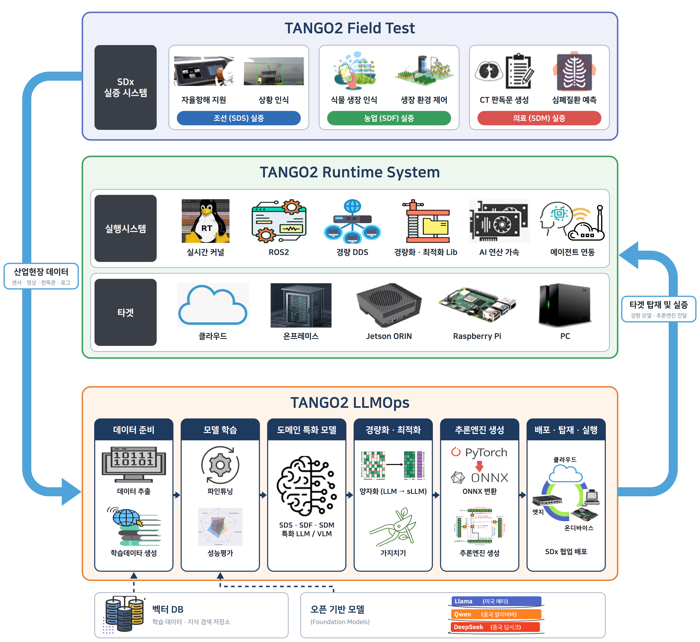
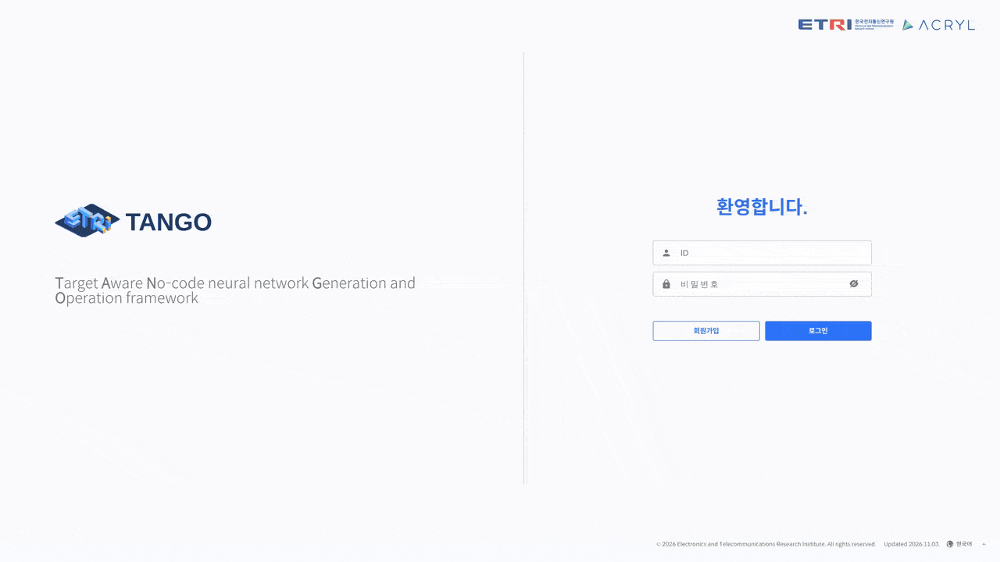
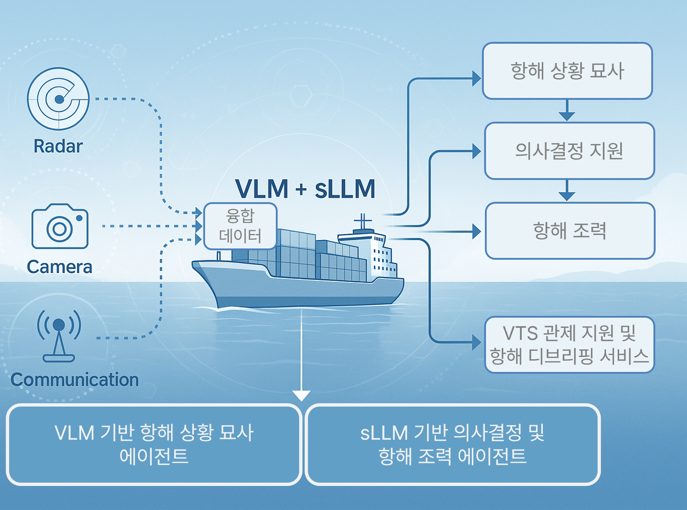
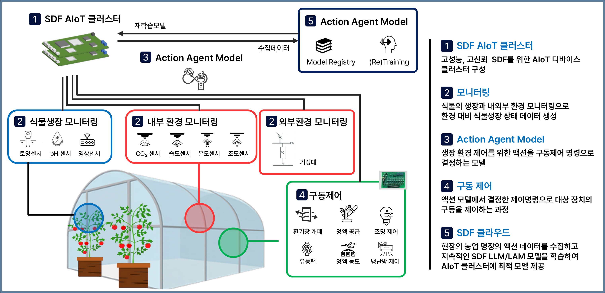
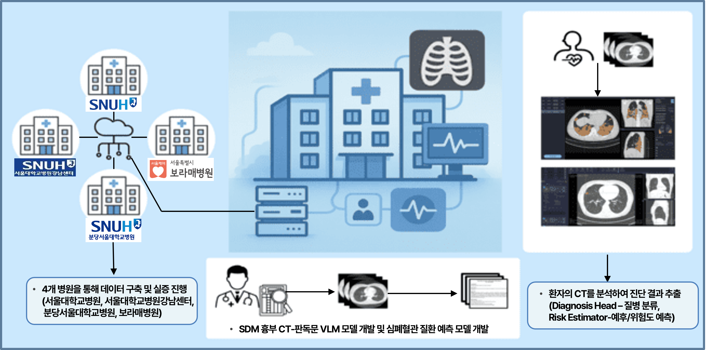
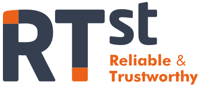
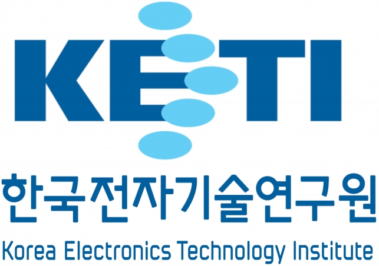
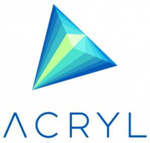

# [**2026 5th TANGO Community Conference**](http://tangoai.or.kr)
* [**STCenter** (과학기술컨벤션센터 / 한국과학기술회관)](https://www.stcenter.or.kr/)
* [**서울시 강남구 테헤란로 7길 22, 과학기술회관 대회의실1** \
(B1F, 22, Teheran-ro 7-gil, Gangnam-gu, Seoul, Republic of Korea)](https://www.google.com/maps/place/%ED%95%9C%EA%B5%AD%EA%B3%BC%ED%95%99%EA%B8%B0%EC%88%A0%ED%9A%8C%EA%B4%80/data=!4m15!1m8!3m7!1s0x357ca157ddbed32f:0x29432bdf4b90af3d!2z7ISc7Jq47Yq567OE7IucIOqwleuCqOq1rCDthYztl6TrnoDroZw36ri4IDIy!3b1!8m2!3d37.500961!4d127.0306229!16s%2Fg%2F11bzn06m8v!3m5!1s0x357ca157de00cbb3:0xe5266ee55f1d179e!8m2!3d37.5007029!4d127.0307453!16s%2Fg%2F1tf8508h?entry=ttu&g_ep=EgoyMDI1MTAxNC4wIKXMDSoASAFQAw%3D%3D)
* **2026-11-11 / 13:30~17:30**

---

# TANGO 2

한국어 | [English](README_en.md) 

TANGO 는 Target Aware No-code neural network Generation and Operation framework 의 약자로,  
타겟 적응형 LLM/VLM 및 비전 ML 신경망을 자동으로 학습하고 배포하는 인공지능 통합개발 도구의 깃허브 오픈소스 프로젝트이다.

<p align="center">

</p>

신경망이 최종적으로 추론될 타겟 장비(클라우드, 온프레미스, 온디바이스)의 HW 성능 특성을 인지하여,  
신경망을 잘 모르는 산업현장(공장, 의료, 조선, 농업 등) 사용자도 쉽게 타겟에 최적화된 신경망을 자동생성/배포할 수 있도록 지원하는 통합개발도구이다.

---

## TANGO History

탱고는 2022년 11월에 깃허브 프로젝트로 시작하였으며, 2025년 7월부터 탱고2 저장소를 새로이 운영하고 있다.  
[탱고1](https://github.com/ML-TANGO/TANGO)은 MLOps 도구이며, 탱고2는 LLMOps 도구이다.  
탱고는 과기정통부/IITP 정부 과제로 진행하고 있으며, 모든 코드는 깃허브 저장소에서 개발되고 있다.  
탱고는 비영리 목적으로는 자유로이 코드 사용이 가능한 GPL 라이선스를 따르고 있다.

탱고는 매해 상반기/하반기 두 번의 [공식 릴리즈](https://github.com/ML-TANGO/TANGO2/releases)를 수행한다.  
또한 탱고는 매해 가을에 커뮤니티 컨퍼런스를 진행해 오고 있다.

- 2022.11.01 1회 TANGO 커뮤니티 컨퍼런스 (AT센터 세계로룸)
- 2023.11.01 2회 TANGO 커뮤니티 컨퍼런스 (과학기술회관)
- 2024.12.05 3회 TANGO 커뮤니티 컨퍼런스 (과학기술회관)
- 2025.11.06 4회 TANGO 커뮤니티 컨퍼런스 (과학기술회관)
- 2026.11.11 5회 TANGO 커뮤니티 컨퍼런스 (과학기술회관)

탱고 컨퍼런스의 포스터, 발표자료, 행사사진 및 언론기사는 [탱고 커뮤니티 홈페이지](https://tangoai.or.kr/)를 통하여 볼 수 있다.

---

## Project Layout

탱고 깃허브 디렉토리의 구조는 다음과 같다.

```bash
TANGO2
   ├── apps                          LLMOps 마이크로서비스 · 잡 컨테이너 소스
   ├── devops                        Helm 차트 · 설치 스크립트 · 설치 문서
   ├── bundles                       앱 차트가 공유하는 values 정본
   ├── front                         웹 UI (React + Vite)
   ├── libs                          공용 스크립트 · 서빙 엔진 이미지 소스
   ├── Data_Augmentation             학습 데이터 증강
   │   └── fewshot_prompting         few-shot 예시 기반 시스템 프롬프트 최적화 서비스
   ├── Evaluation                    LLM 평가 도구
   │   ├── Intent_web                의도/슬롯 평가 (Qwen3 × MixATIS QLoRA 학습 · 평가 웹 콘솔)
   │   ├── Logickor_web              한국어 LLM 벤치마크 LogicKor 학습 · 생성 · 채점 웹 UI
   │   ├── lmeval                    lm-evaluation-harness 벤치마크 평가 대시보드
   │   └── serve                     Intent_web · Logickor_web 를 플랫폼 호스트에서 띄우는 런처
   ├── examples                      협력기관용 계약서 · 템플릿
   ├── docs                          그림 · 플랫폼 문서
   │
   ├── Field_Test                    SDx 실증
   │   ├── SDF                       농업 실증 (스마트팜 AI 의사결정)
   │   │   ├── 원시데이터 수집기     스마트팜 센서 원시 데이터 수집 · 온실 자율 제어
   │   │   ├── 원천데이터 생성기     기상청 데이터 병합 · 이상치 제거 · 학습 데이터셋 생성
   │   │   ├── 제어기                온실 장치 · 시설 정의와 제어 명령 전달
   │   │   └── LAM 학습,추론         xLAM 기반 SDF 모델 파인튜닝 · 추론
   │   ├── SDM                       의료 실증 (흉부 CT 진단 · 위험 예측 · 판독문 생성)
   │   └── SDS                       조선 실증 (선박 자율항행 지원 VLM, EVA)
   │       ├── model                 VLM 구조 (CLIP 비전 인코더 · 프로젝터 · LLM)
   │       ├── data                  학습 · 검증 데이터셋 로더와 JSON
   │       ├── dataset               회차별 SDS 학습 데이터 샘플과 형식 설명
   │       ├── scripts               데이터 변환 · 단계별 학습 · 체크포인트 변환
   │       ├── eval                  검증셋 응답 생성 · 지표 채점 · 집계
   │       ├── demo                  Gradio 데모 앱
   │       ├── demo_video            영상 기반 웹 데모
   │       ├── api                   학습 · 배포 · 추론 FastAPI 서버
   │       ├── helm_chart            쿠버네티스 배포 Helm 차트
   │       ├── tests                 프로젝터 · 체크포인트 · 변환 단위 테스트
   │       ├── results               평가 · 분석 결과물
   │       ├── docs                  아키텍처 · 데모 화면 그림
   │       └── TEMP(기존SDS경로에있던내용)  이전 SDS 코드 보관 (Data_Revision, simulator 등)
   │
   └── Runtime_System                학습된 신경망의 실행 환경
       ├── Deployment                모델 경량화 · 변환 · 실행 코드 · 배포 이미지 생성
       ├── Runtime_Engine            Jetson Orin 실시간 런타임
       │   ├── scheduler             sched_ext 기반 실시간 스케줄러
       │   ├── failover              컨테이너 서비스 장애복구
       │   ├── monitoring            Prometheus · Grafana 모니터링 서버
       │   └── Timestamp             eBPF 기반 패킷 타임스탬프 계측
       └── workload_deploy           서버 · 클러스터 워크로드 배포
           ├── Parallell_Inference   분산 추론용 모델 분할 · ONNX 내보내기
           ├── k8s_autoscaling       Kubernetes 자동 확장 · 우선순위 스케줄링
           └── remoteManager         원격 노드 컨테이너 일괄 관리
```

탱고 깃허브에는 LLMOps 도구뿐만 아니라, LLMOps 의 동작을 검증하기 위한 조선(SDS), 농업(SDF), 의료(SDM) 실증 디렉토리(Field_Test)를 포함하고 있다.  
또한 생성된 신경망이 실제로 동작하는 실행시스템(Runtime_System)도 포함하고 있다.

탱고2는 협의의 의미로 LLMOps 도구를 뜻하며, 광의의 의미로는 실증 및 실행시스템을 모두 포함하는 개념이다.

---

## LLMOps [[상세 보기]](README_LLMOps.md)

LLMOps 도구는 저장소 최상위의 `apps`, `devops`, `bundles`, `front`, `libs`, `Data_Augmentation`, `Evaluation`, `examples` 디렉토리로 구성된다.  
쿠버네티스 클러스터 위에서 학습 데이터 구축, 파인튜닝, 양자화, 배포와 추론, 평가에 이르는 LLM/VLM 개발 전 과정을 웹 UI 로 제공한다.

<p align="center">
</p>

### 도구의 실행 화면

워크스페이스를 고르면 사이드바에 대시보드와 드라이브 카드, 그리고 아래 다섯 메뉴가 보인다.

| 메뉴 | 할 수 있는 일 |
|---|---|
| 데이터 | 학습 데이터 파이프라인. 업로드, 전처리, 필터, 생성, VLM 심사, 사람 검수, 분포 분석, 구성과 분할, 버전 릴리스 |
| 모델 | Hugging Face 모델, 플랫폼 모델, 도메인(SDS) 모델에서 시작하는 LoRA 파인튜닝, 실시간 학습 그래프, 체크포인트 관리, GGUF 양자화 |
| 배포 | 클러스터(vLLM, llama.cpp, TGI, Ollama, Triton, TensorRT-LLM), 온디바이스(엣지), 독립 패키지, 외부 LLM(API) 4 종 배포와 외부 API 게시 |
| 추론 | 실행 중인 배포를 골라 채팅과 데이터셋 추론, VLM 이미지 입력, 프롬프트 최적화 |
| 평가 | 정답 대조(lm-evaluation-harness), LLM 심사(LogicKor), 의도/슬롯 평가(MixATIS), 전문가 검수와 리포트 내보내기 |

화면 사용 흐름은 [사용자 매뉴얼](docs/LLMOps/Tango%20사용자%20매뉴얼_20260323.pdf)에 정리되어 있다.  
메뉴별 기능과 서비스별 역할은 [README_LLMOps.md](README_LLMOps.md)에 있다.

### 도구의 설치 방법

설치는 클러스터 구축, values 파일 작성, 인프라 설치, 앱 설치, 초기 설정의 순서로 진행한다.  
세부 절차는 아래 문서를 따른다.

| 단계 | 문서 |
|---|---|
| 쿠버네티스 클러스터 구축 | [devops/CLUSTER-SETUP.md](devops/CLUSTER-SETUP.md) |
| 플랫폼 설치 (기준 문서) | [devops/INSTALL.md](devops/INSTALL.md) |
| 한국어 상세 설치 매뉴얼 | [devops/Tango GenAI Platform 설치 매뉴얼.md](devops/Tango%20GenAI%20Platform%20설치%20매뉴얼.md) |
| 한국어 간소화 설치 매뉴얼 | [devops/Tango GenAI Platform 설치 간소화 매뉴얼.md](devops/Tango%20GenAI%20Platform%20설치%20간소화%20매뉴얼.md) |
| 빌드와 재배포 | [docs/LLMOps/GenAI_Platform 빌드 및 재배포 가이드.md](docs/LLMOps/GenAI_Platform%20빌드%20및%20재배포%20가이드.md) |

요구사항은 Ubuntu 22.04.5 LTS 이상, Kubernetes v1.34.x, containerd 1.7.29, Helm 3.x, metrics-server, kubelet `maxPods: 250`, NFS 서버 1 대이다.  
단일 노드로도 설치할 수 있으며, 파인튜닝과 GPU 서빙에는 NVIDIA GPU 노드가 필요하다.

### 도구의 실행 방법

클러스터가 준비되면 `devops/` 디렉토리에서 다음 순서로 실행한다.  
모든 통합 스크립트는 `devops/` 에서 실행해야 한다.

```bash
git clone https://github.com/ML-TANGO/TANGO2.git
cd TANGO2/devops

# 1. values 준비 (운영 IP, NFS 경로, 비밀번호를 채운다. 이 파일은 커밋하지 않는다)
cp values.yaml.template values_<서버명>.yaml
mkdir -p ./fb_common_app/helm/file/kube && cp ~/.kube/config ./fb_common_app/helm/file/kube/config

# 2. 인프라 설치
./run_step1_infra_base.sh --system ./gaip_nfs_provisioner/values-system.yaml --efk ./gaip_nfs_provisioner/values-efk.yaml
./run_step2_core_infra.sh  --kong ./gaip_kong/values.yaml --registry ./gaip_registry/values.yaml --mariadb ./gaip_maraidb/values.yaml
./run_step3_optional_obs.sh --prometheus          # 선택: --gpu, --efk, --efk --efk-init

# 3. 플랫폼 앱과 LLM 앱 설치
./run.sh     install -f ./values_<서버명>.yaml
./run_llm.sh install -f ./values_<서버명>.yaml
```

설치가 끝나면 브라우저에서 `http://<노드 IP>:32080` 으로 접속해 `admin` 계정으로 로그인한다.  
워크스페이스를 만들기 전에 관리자 화면에서 스토리지를 등록하고, 사용자와 워크스페이스를 만든다.  
코드를 바꾼 뒤 반영하는 방법은 `./run.sh upgrade` 와 `./run_llm.sh upgrade` 이다.

### 도구의 매뉴얼

| 문서 | 내용 |
|---|---|
| [docs/LLMOps/README.md](docs/LLMOps/README.md) | 플랫폼 문서 전체 목차 |
| [docs/LLMOps/Tango 사용자 매뉴얼_20260323.pdf](docs/LLMOps/Tango%20사용자%20매뉴얼_20260323.pdf) | 일반 사용자용 웹 UI 사용 흐름 |
| [docs/LLMOps/Tango2_Platform_활용_가이드_해양VLM.pdf](docs/LLMOps/Tango2_Platform_활용_가이드_해양VLM.pdf) | 해양 VLM 도메인 적용 사례 |
| [docs/LLMOps/Tango 모델 탑재 가이드.md](docs/LLMOps/Tango%20모델%20탑재%20가이드.md) | 모델 탑재 요건, 서빙 엔진, GGUF 양자화 |
| [docs/LLMOps/Tango MSA 탑재 가이드.md](docs/LLMOps/Tango%20MSA%20탑재%20가이드.md) | 협력기관 서비스 탑재 |
| [examples/hello-plugin/external-container-spec.md](examples/hello-plugin/external-container-spec.md) | 외부 컨테이너 인터페이스 계약서 |
| [examples/edge-agent/README.md](examples/edge-agent/README.md) | 엣지 에이전트 연동 규약 |
| [docs/LLMOps/Tango2_GenAI_Platform_용어_정의서_v1.3.md](docs/LLMOps/Tango2_GenAI_Platform_용어_정의서_v1.3.md) | 용어 정의서 |

---

## Field_Test

세 개 SDx 분야에서 TANGO 2 를 실증한다.

### SDS [[상세 보기]](Field_Test/SDS/README.md)

<p align="center">
</p>

Software Defined Ship (SDS).  
기존 센서 융합 기술을 이용한 인식 중심 AI 에이전트 개발을 넘어, 탐지된 주변 물체와 환경 정보를 바탕으로 상황을 이해하고 서술하며, 항법 규칙에 따라 상황에 맞는 항해 결정을 내리는 것을 실증한다.

### SDF [[상세 보기]](Field_Test/SDF/README.md)

<p align="center">
</p>

Software Defined Farming (SDF).  
스마트팜 고도화를 위해 LLM 과 Large Action Model (LAM) 기반 인공지능 시스템을 구축하고, AI 모델의 지속 학습을 통해 지능형 SDF 를 검증한다.

### SDM [[상세 보기]](Field_Test/SDM/README.md)

<p align="center">
</p>

Software Defined Medicine (SDM).  
의료 도메인 특화 멀티모달(흉부 CT 판독) 인공지능인 대형 시각언어모델(Large Vision-Language Model) 기반 SDM 시스템을 개발하고 병원에서 실증하였다.

---

## Runtime_System [[상세 보기]](Runtime_System/README.md)

학습된 신경망을 실제 운영 환경에 올려 실행하기까지의 런타임 구성 요소이다.  
플랫폼 클러스터 바깥에서 배포 대상 하드웨어를 직접 다룬다.

| 구성 요소 | 역할 | 주 대상 |
|---|---|---|
| [Deployment](Runtime_System/Deployment/README.md) | 모델 변환, 경량화, 실행 코드 및 배포 이미지 생성 | 공통 (선행 단계) |
| [Runtime_Engine](Runtime_System/Runtime_Engine/README.md) | 실시간 스케줄링, 장애복구, 계측, 모니터링 | 엣지 단말 (Jetson Orin) |
| [workload_deploy](Runtime_System/workload_deploy/README.md) | 모델 분할, 자동 확장, 원격 노드 관리 | 서버 / Kubernetes 클러스터 |

---

## TANGO Community
TANGO Community 는 누구나 쉽게 AI 의 세계에 들어올 수 있도록 설계된 인공지능 민주화 플랫폼이다. 커뮤니티는 매년 컨퍼런스를 열어 성과를 공유하고 기술 지평을 넓힌다.  
[_<ins>누구에게나 열려 있는 커뮤니티에 참여해 보세요!</ins>_](http://tangoai.or.kr)

## License

이 프로젝트는 [`LICENSE.md`](LICENSE.md) 의 조건에 따라 공개된다 (한국어 버전: [`LICENSE_ko.md`](LICENSE_ko.md)).  
비영리 목적으로는 자유로이 코드 사용이 가능한 GPLv3 라이선스를 따르고 있으며, 사업화를 위해서는 코드 공개 의무가 없는 **기술이전**(기술이전명:  [탱고 인공지능 통합개발 도구](https://itec.etri.re.kr/httx/itec/sub02/sub02_01_1.do?t_id=1520-2026-00820&nowPage=1&nowBlock=0&adminYn=&searchDate1=&searchDate2=&m_code=002&searchKey=b_total&searchWord=))을 통하여 가능하다.

## Acknowledgement <a name="ack"></a>

이 연구는 과학기술정보통신부의 재원으로 [정보통신기획평가원(IITP)](https://www.iitp.kr/)의 지원을 받아 수행되었다 (**No. RS-2025-25442867**, _SDx 지능형 서비스의 최적 실행을 위한 생성형 AI 지원 시스템 소프트웨어 프레임워크 개발_).

---

<p align="center">
    <a href="https://www.etri.re.kr/kor/main/main.etri">
        </a>
    <a href="https://www.tta.or.kr/tta/index.do">
        </a>
</p>

<p align="center">
    <a href="https://www.rtst.co.kr/">
        </a>
    <a href="https://www.keti.re.kr/main/main.php">
        </a>
    <a href="https://www.acryl.ai/kr/">
        </a>
    <a href="https://slpl.korea.ac.kr/">
        </a>
    <a href="https://aivenautics.com/">
        </a>
    <a href="https://suredatalab.com/site/">
        </a>
    <a href="https://www.snuh.org/intro.do">
        </a>
</p>

---
