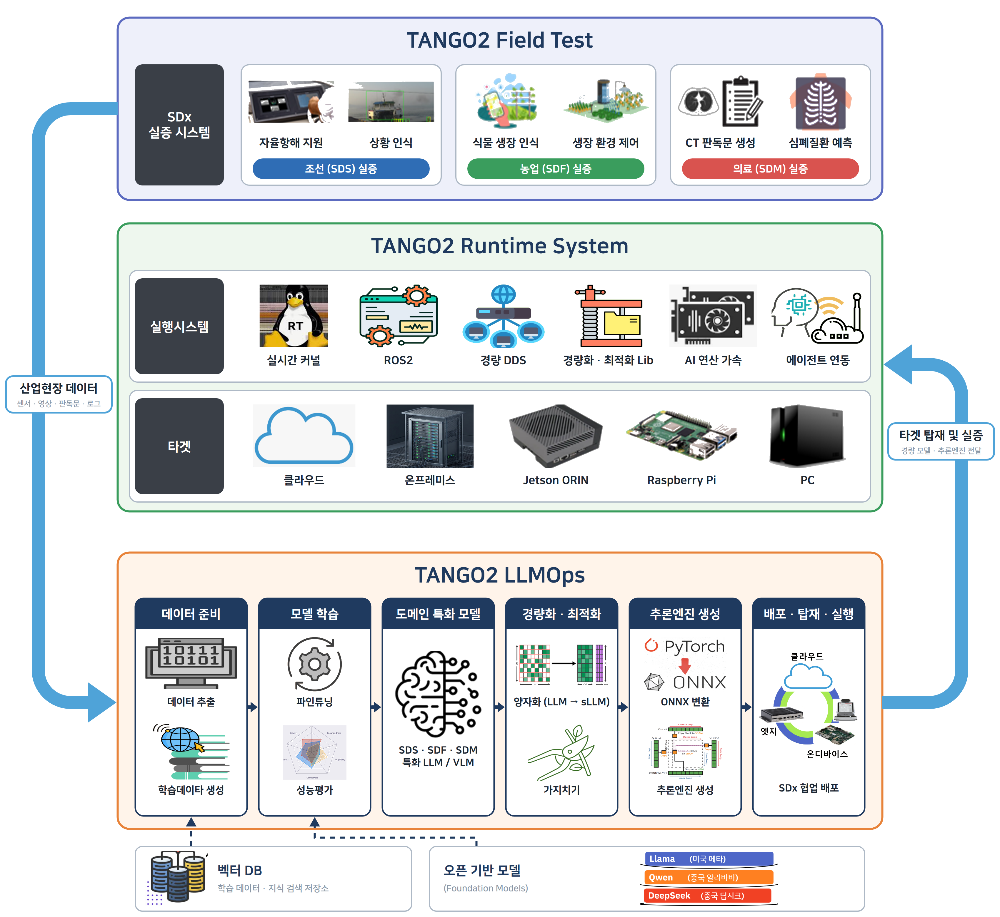
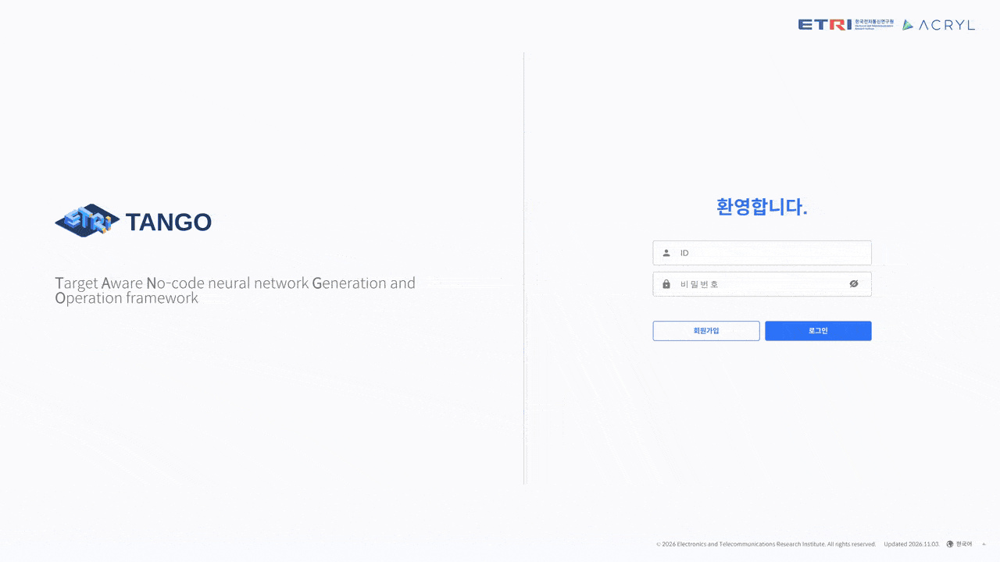
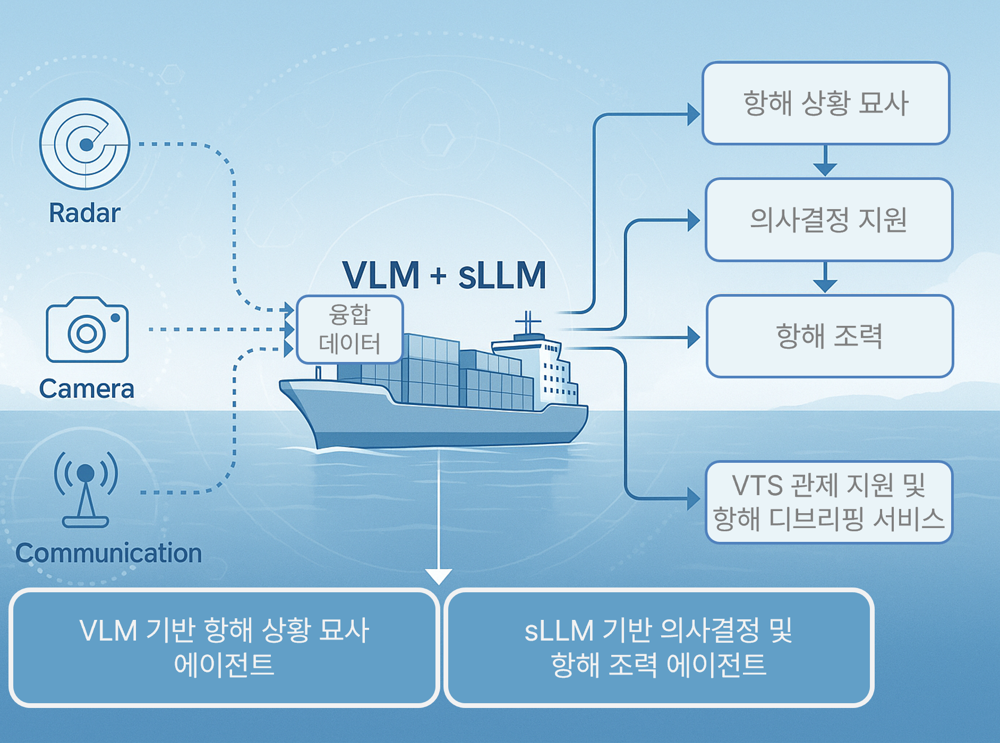
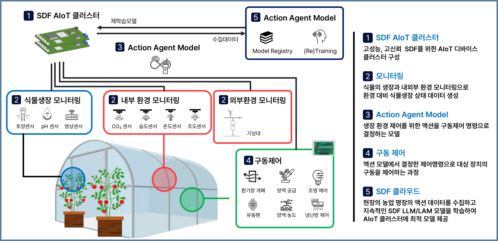
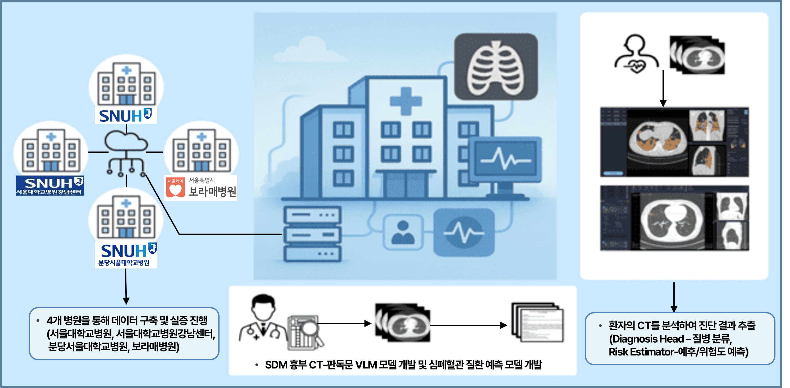
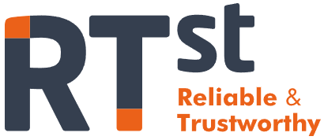
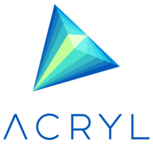

# [**2026 5th TANGO Community Conference**](http://tangoai.or.kr)
* [**STCenter** (과학기술컨벤션센터 / 한국과학기술회관)](https://www.stcenter.or.kr/)
* [**B1F, 22, Teheran-ro 7-gil, Gangnam-gu, Seoul, Republic of Korea** \
(서울시 강남구 테헤란로 7길 22, 과학기술회관 대회의실1)](https://www.google.com/maps/place/%ED%95%9C%EA%B5%AD%EA%B3%BC%ED%95%99%EA%B8%B0%EC%88%A0%ED%9A%8C%EA%B4%80/data=!4m15!1m8!3m7!1s0x357ca157ddbed32f:0x29432bdf4b90af3d!2z7ISc7Jq47Yq567OE7IucIOqwleuCqOq1rCDthYztl6TrnoDroZw36ri4IDIy!3b1!8m2!3d37.500961!4d127.0306229!16s%2Fg%2F11bzn06m8v!3m5!1s0x357ca157de00cbb3:0xe5266ee55f1d179e!8m2!3d37.5007029!4d127.0307453!16s%2Fg%2F1tf8508h?entry=ttu&g_ep=EgoyMDI1MTAxNC4wIKXMDSoASAFQAw%3D%3D)
* **2026-11-11 / 13:30~17:30**

---

# TANGO 2

[한국어](README.md) | English

TANGO stands for Target Aware No-code neural network Generation and Operation framework.  
It is an open-source GitHub project for an integrated AI development tool that automatically trains and deploys target-adaptive LLM/VLM and vision ML neural networks.

<p align="center">

</p>

The tool recognizes the hardware characteristics of the target device (cloud, on-premises, on-device) on which the neural network will finally run inference.  
It lets industrial-site users (factories, hospitals, shipyards, farms, and so on) who are unfamiliar with neural networks automatically generate and deploy a neural network optimized for their target.

---

## TANGO History

TANGO started as a GitHub project in November 2022, and the TANGO 2 repository has been operated separately since July 2025.  
[TANGO 1](https://github.com/ML-TANGO/TANGO) is an MLOps tool, and TANGO 2 is an LLMOps tool.  
TANGO is carried out as a government project funded by MSIT/IITP, and all code is developed in the GitHub repository.  
TANGO follows the GPL license, which allows free use of the code for non-commercial purposes.

TANGO makes two [official releases](https://github.com/ML-TANGO/TANGO2/releases) every year, one in the first half and one in the second half.  
TANGO has also held a community conference every autumn.

- 2022.11.01 1st TANGO Community Conference (aT Center, Segyero Room)
- 2023.11.01 2nd TANGO Community Conference (Science and Technology Center)
- 2024.12.05 3rd TANGO Community Conference (Science and Technology Center)
- 2025.11.06 4th TANGO Community Conference (Science and Technology Center)
- 2026.11.11 5th TANGO Community Conference (Science and Technology Center)

Posters, presentation slides, event photos, and press articles from the TANGO conferences are available on the [TANGO Community website](https://tangoai.or.kr/).

---

## Project Layout

The TANGO GitHub directory is organized as follows.

```bash
TANGO2
   ├── apps                          LLMOps microservice and job container sources
   ├── devops                        Helm charts, install scripts, install documents
   ├── bundles                       Canonical values shared by the app charts
   ├── front                         Web UI (React + Vite)
   ├── libs                          Shared scripts and serving engine image sources
   ├── Data_Augmentation             Training data augmentation
   │   └── fewshot_prompting         System prompt optimization service from few-shot examples
   ├── Evaluation                    LLM evaluation tools
   │   ├── Intent_web                Intent/slot evaluation (Qwen3 × MixATIS QLoRA training and evaluation web console)
   │   ├── Logickor_web              Web UI for the LogicKor Korean LLM benchmark (train, generate, score)
   │   ├── lmeval                    lm-evaluation-harness benchmark evaluation dashboard
   │   └── serve                     Launcher that serves Intent_web and Logickor_web on the platform host
   ├── examples                      Contracts and templates for partner organizations
   ├── docs                          Figures and platform documents
   │
   ├── Field_Test                    SDx field demonstrations
   │   ├── SDF                       Farming (smart farm AI decision making)
   │   │   ├── 원시데이터 수집기     Smart farm sensor raw data collection and greenhouse control
   │   │   ├── 원천데이터 생성기     KMA weather data merging, outlier removal, training dataset generation
   │   │   ├── 제어기                Greenhouse device/facility definitions and control command delivery
   │   │   └── LAM 학습,추론         Fine-tuning and inference of the xLAM-based SDF model
   │   ├── SDM                       Medicine (chest CT diagnosis, risk prediction, report generation)
   │   └── SDS                       Shipbuilding (vessel navigation support VLM, EVA)
   │       ├── model                 VLM structure (CLIP vision encoder, projector, LLM)
   │       ├── data                  Training/validation dataset loaders and JSON
   │       ├── dataset               SDS training data samples and format per release
   │       ├── scripts               Data conversion, phased training, checkpoint conversion
   │       ├── eval                  Validation set generation, metric scoring, aggregation
   │       ├── demo                  Gradio demo app
   │       ├── demo_video            Video-based web demo
   │       ├── api                   FastAPI server for training, deployment, inference
   │       ├── helm_chart            Helm chart for Kubernetes deployment
   │       ├── tests                 Unit tests for projector, checkpoint, conversion
   │       ├── results               Evaluation and analysis results
   │       ├── docs                  Architecture and demo screenshots
   │       └── TEMP(기존SDS경로에있던내용)  Archive of previous SDS code (Data_Revision, simulator, etc.)
   │
   └── Runtime_System                Runtime environment for trained neural networks
       ├── Deployment                Model lightweighting, conversion, execution code, deployment images
       ├── Runtime_Engine            Real-time runtime for Jetson Orin
       │   ├── scheduler             sched_ext-based real-time scheduler
       │   ├── failover              Container service failover
       │   ├── monitoring            Prometheus and Grafana monitoring server
       │   └── Timestamp             eBPF-based packet timestamp instrumentation
       └── workload_deploy           Server and cluster workload deployment
           ├── Parallell_Inference   Model splitting and ONNX export for split inference
           ├── k8s_autoscaling       Kubernetes autoscaling and priority scheduling
           └── remoteManager         Bulk container management on remote nodes
```

In addition to the LLMOps tool, the TANGO GitHub repository contains the field demonstration directories (Field_Test) for shipbuilding (SDS), farming (SDF), and medicine (SDM) that verify the operation of LLMOps.  
It also contains the runtime system (Runtime_System) on which the generated neural networks actually run.

In the narrow sense, TANGO 2 means the LLMOps tool. In the broad sense, it covers the field demonstrations and the runtime system as well.

---

## LLMOps [[View Details]](README_LLMOps.md)

The LLMOps tool consists of the top-level `apps`, `devops`, `bundles`, `front`, `libs`, `Data_Augmentation`, `Evaluation`, and `examples` directories.  
On a Kubernetes cluster, it provides the entire LLM/VLM development process through a web UI, from training data construction, fine-tuning, and quantization to deployment, inference, and evaluation.

<p align="center">
</p>

### Tool Screens

After selecting a workspace, the sidebar shows the dashboard and drive cards along with the five menus below.

| Menu | What you can do |
|---|---|
| Data | Training data pipeline. Upload, preprocessing, filtering, generation, VLM review, human review, distribution analysis, composition and splitting, version release |
| Model | LoRA fine-tuning starting from Hugging Face models, platform models, or domain (SDS) models, real-time training graphs, checkpoint management, GGUF quantization |
| Deployment | Four deployment types, cluster (vLLM, llama.cpp, TGI, Ollama, Triton, TensorRT-LLM), on-device (edge), standalone package, and external LLM (API), plus external API publishing |
| Inference | Select a running deployment for chat and dataset inference, VLM image input, prompt optimization |
| Evaluation | Answer matching (lm-evaluation-harness), LLM judging (LogicKor), intent/slot evaluation (MixATIS), expert review and report export |

The screen usage flow is described in the [User Manual](docs/LLMOps/Tango%20사용자%20매뉴얼_20260323.pdf).  
The functions of each menu and the role of each service are in [README_LLMOps.md](README_LLMOps.md).

### Tool Installation

Installation proceeds in the order of cluster setup, values file preparation, infrastructure installation, app installation, and initial configuration.  
Follow the documents below for the detailed procedure.

| Step | Document |
|---|---|
| Kubernetes cluster setup | [devops/CLUSTER-SETUP.md](devops/CLUSTER-SETUP.md) |
| Platform installation (reference document) | [devops/INSTALL.md](devops/INSTALL.md) |
| Detailed installation manual (Korean) | [devops/Tango GenAI Platform 설치 매뉴얼.md](devops/Tango%20GenAI%20Platform%20설치%20매뉴얼.md) |
| Simplified installation manual (Korean) | [devops/Tango GenAI Platform 설치 간소화 매뉴얼.md](devops/Tango%20GenAI%20Platform%20설치%20간소화%20매뉴얼.md) |
| Build and redeploy | [docs/LLMOps/GenAI_Platform 빌드 및 재배포 가이드.md](docs/LLMOps/GenAI_Platform%20빌드%20및%20재배포%20가이드.md) |

The requirements are Ubuntu 22.04.5 LTS or later, Kubernetes v1.34.x, containerd 1.7.29, Helm 3.x, metrics-server, kubelet `maxPods: 250`, and one NFS server.  
A single-node installation is possible. Fine-tuning and GPU serving require an NVIDIA GPU node.

### Running the Tool

Once the cluster is ready, run the following in order from the `devops/` directory.  
All integrated scripts must be run from `devops/`.

```bash
git clone https://github.com/ML-TANGO/TANGO2.git
cd TANGO2/devops

# 1. Prepare values (fill in the production IP, NFS path, and passwords. Do not commit this file)
cp values.yaml.template values_<server-name>.yaml
mkdir -p ./fb_common_app/helm/file/kube && cp ~/.kube/config ./fb_common_app/helm/file/kube/config

# 2. Install infrastructure
./run_step1_infra_base.sh --system ./gaip_nfs_provisioner/values-system.yaml --efk ./gaip_nfs_provisioner/values-efk.yaml
./run_step2_core_infra.sh  --kong ./gaip_kong/values.yaml --registry ./gaip_registry/values.yaml --mariadb ./gaip_maraidb/values.yaml
./run_step3_optional_obs.sh --prometheus          # optional: --gpu, --efk, --efk --efk-init

# 3. Install the platform apps and the LLM apps
./run.sh     install -f ./values_<server-name>.yaml
./run_llm.sh install -f ./values_<server-name>.yaml
```

After installation, open `http://<node IP>:32080` in a browser and log in with the `admin` account.  
Before creating a workspace, register storage in the admin screen, then create users and workspaces.  
To apply code changes, use `./run.sh upgrade` and `./run_llm.sh upgrade`.

### Tool Manuals

| Document | Contents |
|---|---|
| [docs/LLMOps/README.md](docs/LLMOps/README.md) | Full table of contents of the platform documents |
| [docs/LLMOps/Tango 사용자 매뉴얼_20260323.pdf](docs/LLMOps/Tango%20사용자%20매뉴얼_20260323.pdf) | Web UI usage flow for general users |
| [docs/LLMOps/Tango2_Platform_활용_가이드_해양VLM.pdf](docs/LLMOps/Tango2_Platform_활용_가이드_해양VLM.pdf) | Maritime VLM domain application case |
| [docs/LLMOps/Tango 모델 탑재 가이드.md](docs/LLMOps/Tango%20모델%20탑재%20가이드.md) | Model onboarding requirements, serving engines, GGUF quantization |
| [docs/LLMOps/Tango MSA 탑재 가이드.md](docs/LLMOps/Tango%20MSA%20탑재%20가이드.md) | Onboarding services from partner organizations |
| [examples/hello-plugin/external-container-spec.md](examples/hello-plugin/external-container-spec.md) | External container interface contract |
| [examples/edge-agent/README.md](examples/edge-agent/README.md) | Edge agent integration protocol |
| [docs/LLMOps/Tango2_GenAI_Platform_용어_정의서_v1.3.md](docs/LLMOps/Tango2_GenAI_Platform_용어_정의서_v1.3.md) | Glossary |

---

## Field_Test

TANGO 2 is demonstrated in three SDx domains.

### SDS [[View Details]](Field_Test/SDS/README.md)

<p align="center">
</p>

Software Defined Ship (SDS).  
Going beyond the development of perception-centered AI agents using existing sensor fusion technology, we demonstrate that the agent understands and describes situations based on detected surrounding objects and environmental information, and makes navigation decisions appropriate to the situation according to navigation rules.

### SDF [[View Details]](Field_Test/SDF/README.md)

<p align="center">
</p>

Software Defined Farming (SDF).  
To advance smart farms, we build an AI system based on an LLM and a Large Action Model (LAM) and verify intelligent SDF through continuous learning of the AI models.

### SDM [[View Details]](Field_Test/SDM/README.md)

<p align="center">
</p>

Software Defined Medicine (SDM).  
We developed an SDM system based on a medical domain-specific, multimodal (chest CT interpretation) Large Vision-Language Model and demonstrated it in a hospital.

---

## Runtime_System [[View Details]](Runtime_System/README.md)

These are the runtime components that take a trained neural network to the point where it runs in a real operating environment.  
They handle the deployment target hardware directly, outside the platform cluster.

| Component | Role | Main target |
|---|---|---|
| [Deployment](Runtime_System/Deployment/README.md) | Model conversion, lightweighting, generation of execution code and deployment images | Common (preceding step) |
| [Runtime_Engine](Runtime_System/Runtime_Engine/README.md) | Real-time scheduling, failover, instrumentation, monitoring | Edge devices (Jetson Orin) |
| [workload_deploy](Runtime_System/workload_deploy/README.md) | Model partitioning, autoscaling, remote node management | Servers / Kubernetes clusters |

---

## TANGO Community
TANGO Community is an AI democratization platform designed so that anyone can easily enter the world of AI. The community holds an annual conference to share its achievements and broaden its technological horizons.  
[_<ins>Feel free to join our fully open community!</ins>_](http://tangoai.or.kr)

## License

This project is released under the terms in [`LICENSE.md`](LICENSE.md) (Korean version: [`LICENSE_ko.md`](LICENSE_ko.md)).

## Acknowledgement <a name="ack"></a>

This project was supported by the [Institute of Information & Communications Technology Planning & Evaluation (IITP)](https://www.iitp.kr/) grant funded by the Ministry of Science and ICT (MSIT), Republic of Korea (**No. RS-2025-25442867**, _Development of a Generative AI-Supported System Software Framework for Optimal Execution of SDx Intelligent Services_).

---

<p align="center">
    <a href="https://www.etri.re.kr/kor/main/main.etri">
        </a>
    <a href="https://www.tta.or.kr/tta/index.do">
        </a>
</p>

<p align="center">
    <a href="https://www.rtst.co.kr/">
        </a>
    <a href="https://www.keti.re.kr/main/main.php">
        </a>
    <a href="https://www.acryl.ai/kr/">
        </a>
    <a href="https://slpl.korea.ac.kr/">
        </a>
    <a href="https://aivenautics.com/">
        </a>
    <a href="https://suredatalab.com/site/">
        </a>
    <a href="https://www.snuh.org/intro.do">
        </a>
</p>

---
