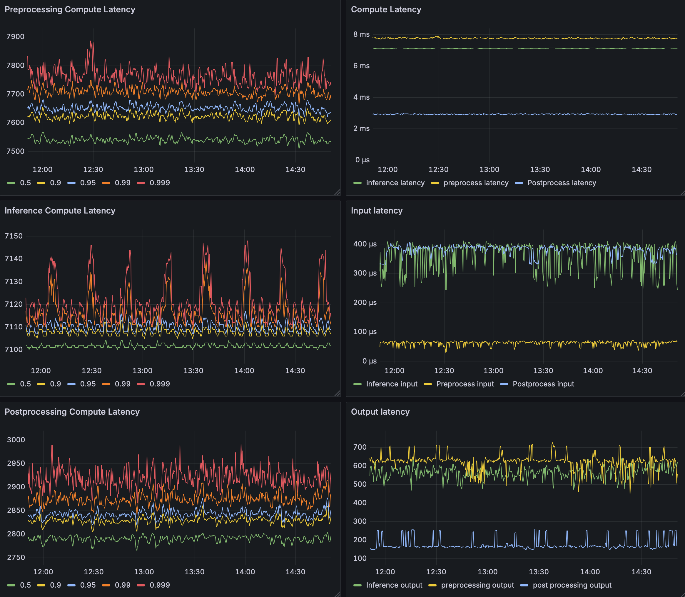

# 모니터링 서버

Prometheus가 Triton 서버와 Orin LLM exporter의 지표를 수집하고 Grafana가
표시합니다. OpenTelemetry Collector·Tempo는 기존 추적 수집에 사용합니다.

## 최초 설치

Docker Compose v2가 있는 Linux 서버에서 실행합니다. `monitoring/`의
서버 설정과 기존 `otel/`·`grafana/tempo/` 설정을 함께 배치합니다.
Grafana 초기 비밀번호는 `GRAFANA_ADMIN_PASSWORD` 환경변수로 지정합니다.

```bash
cd monitoring
docker compose up -d
```

Grafana는 `http://서버주소:3000`, Prometheus는 `http://서버주소:9090`입니다.
Triton 서버와 LLM 계측 실행기·exporter는 각각의 추론 호스트에서 실행합니다.

## Triton 지표 연결

기존 Triton 모니터링도 함께 사용합니다. 서버의
`prometheus/targets/triton/targets.json`에 Triton metrics 주소를 지정합니다.

```json
[
  {
    "targets": ["TRITON_ADDRESS:8002"],
    "labels": {"service": "triton"}
  }
]
```

Triton의 `/metrics`를 `triton` job으로 수집합니다. 기존
`grafana/provisioning/dashboards/boards/triton.json`의 **inference latency**
dashboard에서 전처리·추론·후처리, 입출력·큐·E2E 지연과 CPU·GPU 지표를 봅니다.
기본 모델명은 `yx_preproc`·`yx_trt`·`yx_postproc`·`yolox_e2e`입니다.
지연 summary는 Triton의 `--metrics-config=summary_latencies=true`로 활성화하고,
dashboard의 모델명·분위수를 서버 설정에 맞춥니다.



## LLM 지표 연결

Orin exporter는 TCP 9464의 `/metrics`를 제공합니다. target JSON의 주소를
서버에서 접근할 수 있는 Orin 주소로 바꿉니다. 서버의 `monitoring/`에서
다음과 같이 배치합니다.

```bash
sudo install -d prometheus/targets/tango2 grafana/provisioning/dashboards/boards
sudo install -m 0644 llm-stages/prometheus-target.json \
  prometheus/targets/tango2/agx-llm-stages.json
sudo install -m 0644 llm-stages/grafana-dashboard.json \
  grafana/provisioning/dashboards/boards/tango2-agx-llm-stages.json
```

Prometheus의 `tango2` job과 Grafana provider가 각각 30초 간격으로 파일을
반영합니다. 이후 target·dashboard 변경에는 컨테이너 재시작이 필요 없습니다.
제공한 datasource 설정은 LLM dashboard와 같은 Prometheus UID를 사용합니다.
기존 설치에 다른 UID가 있다면 dashboard의 datasource UID를 맞춥니다.

공용 운영 서버의 설치 루트는 `/opt/monitoring`입니다. 이미 운영 중이면
새 stack을 띄우지 않고 위 파일을 기존 설치 루트에 반영합니다.
기존 Compose·Prometheus 기본 설정을 처음 교체하는 작업은 별도 반영이 필요합니다.

## 확인

```bash
docker compose ps
curl -fsS http://TRITON_ADDRESS:8002/metrics
curl -fsS http://ORIN_ADDRESS:9464/metrics
```

Prometheus의 `/targets`에서 각 target이 `UP`인지 확인하고, Grafana에서
**inference latency** 또는 **TANGO2 AGX — LLM Stage Performance**를 엽니다.
exporter가 실행 중이어도 계측 실행기의 요청 기록이 있어야 그래프가 표시됩니다.
